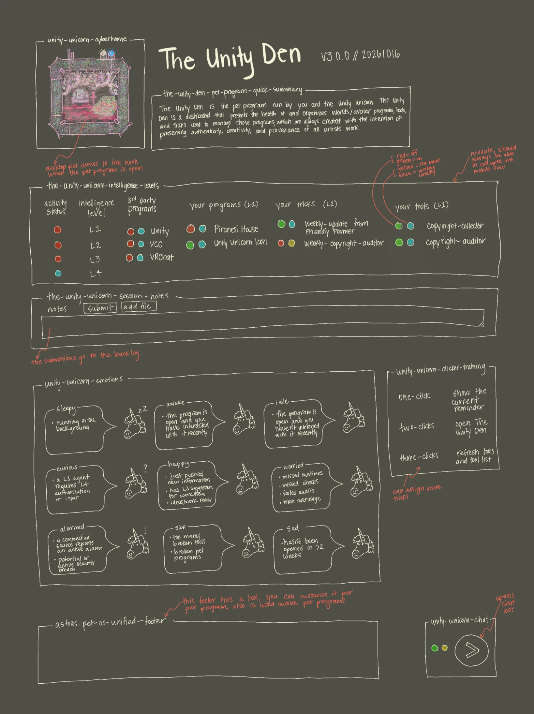

# Pet Program Framework

The standard every pet program follows: what its page shows, how its tools, data, versions, backlog and agents
work, and how security patches reach every farm. Written from Astra's instructions of 2026-10-13 by Claude Opus 5.5;
the page layout redrawn from her sketch of 2026-10-18 by Claude Opus 5.5 (`claude-opus-5-5`), 2026-10-18.
**Every new pet program is built to this, and every existing one is brought up to it.**

> 🐾 Everything inside the harness is an animal. Agents can only control animals. L4 approves everything that matters.

## 1. Words (developer language, no marketing)

| Word | Meaning |
|---|---|
| **L1** Programs | The third-party programs it runs, plus the programs and tools it creates. |
| **L2** Pet program | The pet's dashboard and its runtime: it runs by itself (schedule, checks, inbox, saved state). |
| **L3** Agentic harness | An AI model sits in the pet program's harness, becomes its agent, and does its tasks with its tools and tricks. |
| **L4** Verified human | The verified human who owns the entire secure ecosystem (on Astra's farm: Astra). Every security change, every permission and every exception to a default is approved by L4. On another user's farm, that user is L4. |
| Pet program icon | The character (Friendly Farmer). |
| Pet program | The one main program a pet stands for (The Farm). |
| Native program | A program, site, world or app Astra made that is opened or run on its own (Startup Star, Ghost Protocol). The only thing a pet program owns that the System Map draws (Astra, 2026-10-19). |
| Control panel | What a pet program page is (Astra, 2026-10-19): it shows how the pet's things are and gives you the switches. Anything too big for a tool panel becomes its own website, a native program the pet program manages (section 3). Developers say dashboard or admin console. |
| Tool | Code a pet program owns and runs with no AI: a script, page section, editor tool or plugin. Same ring and permissions as its pet program, never more. Listed on its pet program's card, never drawn on the System Map (Astra, 2026-10-19). |
| Trick | Written steps the pet's seated AI follows with its tools (a `SKILL.md`). Listed on its pet program's card, never drawn. Every native program, tool and trick is in the registry table in [TOOLS-AND-TRICKS.md](TOOLS-AND-TRICKS.md). |
| Tool box | How a tool appears on a page: a bordered box with its versioned label on the top border and everything about the tool inside. |
| Tool panel | A bordered, collapsible group on a pet program page, its label set into the top border (`unity-unicorn-L1-tool-panel`). Tool panels hold the tool, connection and notes boxes. Called a **module**, then a **panel**, until 2026-10-19: to developers a module is a file of code (Astra, 2026-10-19: "I do want all of it to say tool panel instead of just panel"). |
| Connection box | How a link to another pet appears: a box with a border of its own colour (never the tool box colour), titled with just the other pet's **pet program icon** name, as if the two are talking. Inside: what flows each way. |
| Third-party | Programs, libraries and services made by others. |
| Maker agent / checker agent | The agent that proposes and applies a change, and a separate read-only agent that verifies it (the maker-checker rule). |
| Backlog | The never-lost list of notes, screenshots and change requests for a pet program. |

## 2. Names and versions: everywhere

Versions start with `v`, like git tags. A name keeps its number; a version never hides inside it.

| Thing | Pattern | Example |
|---|---|---|
| Pet program (no name yet) | `pet-program-<#>-v<version>` | `pet-program-3-v1.0` |
| Pet program (named) | `<pet-program>-v<version>` | `the-farm-v1.0` |
| Icon (mood 1 to 9) | `<pet-program>-v<version>-icon-<mood>-v<icon version>` | `pet-program-3-v1.0-icon-2-v1.0.png` |
| Tool box label | `<pet-program>-v<version>-<tool>-v<tool version>` | `pet-program-3-v1.0-notes-tool-v1.0`, `the-farm-v1.0-pet-privatizer-v1.0`, `pet-program-5-v1.0-harness-strapper-v1.0` |
| Backlog (the store) | `<pet-program>-backlog` | `the-farm-backlog` |
| Backlog entry | `<pet-program>-v<version>-backlog-<YYYYMMDD>-<NNN>` | `the-farm-v1.0-backlog-20261013-001` |
| Weekly backlog run | `<pet-program>-v<version>-backlog-run-<YYYYMMDD>` | `the-farm-v1.0-backlog-run-20261019` |

The backlog store is the one name without a version, on purpose: it belongs to the pet program across every version,
so it is never lost. Every entry and every run inside it carries the version it was written against.
Mood numbers: 1 idle, 2 awake (`blink`), 3 happy, 4 curious, 5 worried, 6 sad, 7 sick, 8 alarmed, 9 sleepy (`sleep`).
What each one means: section 3, `<pet>-emotions`.

## 3. The page, top to bottom

### A pet program is a control panel (Astra, 2026-10-19)

A pet program page is a **control panel**: it shows at a glance how the pet's programs, tools and tricks are doing,
and gives you the switches (the paired lights, short lists, buttons, a note box). It is not where big work happens.
**When something gets too big to fit on a tool panel, it becomes its own website, which the pet program manages.**

- **Too big** means it needs a screen of its own: its own tabs or menus, an editor, a gallery, a long list you scroll
  and search, or a place you would open by itself to work in.
- **Its own website** is a native program of the pet program: a page in the pet's repo (`<name>-<YYYYMMDD>.html`),
  or a repo of its own when it grows that big (a new repo needs Astra's OK). It is opened on its own, so the System
  Map draws it, and the registry table in [TOOLS-AND-TRICKS.md](TOOLS-AND-TRICKS.md) lists it.
- **The page keeps one tool panel for it:** its paired lights, a line or two on how it is doing (counts, the last
  change, anything that needs you) and an **Open** button. The panel manages the website; it does not hold it.
- Small tools stay on the page: a tool box with its lights, one line on what it does, and its button.

### Layout (Astra's sketch, 2026-10-18): this order wins over the list below

This sketch is the **minimum every pet program page contains** (Astra, 2026-10-18). It replaces her sketch of
2026-10-16, which was never saved here. Astra's answers of the same day change two things in it: the intelligence
levels are **four stacked tool panels**, one per level, and the lights are **buttons**. The Unity Unicorn's page is the
example; [docs/unity-unicorn-page-modules-20261018.md](docs/unity-unicorn-page-modules-20261018.md) puts every one of
its tools and tricks in its tool panel.

Dark slate stationery and light, hand-lettered text. Every group is a **tool panel**: a thin bordered box with its label
set into the top border, in lowercase-with-hyphens, starting with the pet's name (`unity-unicorn-L1-tool-panel`).
**The page keeps a quiet frame** (Astra, 2026-10-14, brought back 2026-10-19: "what happened to the 1-inch margin thing,
or the 0.75-inch margin thing? Do that"): about 0.75 inch (72 CSS pixels) of outer margin on a big screen, less as the
window narrows, 16px on a phone. CSS inches are not real inches on every screen.
**Every tool panel can collapse**, so the page works on a phone. The tool, notes and connection boxes from the list below
go inside the matching tool panel here. **Panels, not modules** (Astra, 2026-10-19): these were called modules until then,
but to a developer a module is a file of code (every `.mjs` script in this repo is one), so a box on a page is a panel. Since the same day every panel is a **tool panel** (Astra, 2026-10-19: "I do want all of it to say tool panel instead of just panel").

1. **`<pet>-cyberhome`** (top left): the pet's habitat. The desktop pet comes to live here while the page is
   open. Its paired lights sit inside its top corner, off the border line (Astra,
   2026-10-20: "Move those indicator lights down. They are in the way of the line"). **It is empty until the page
   opens; then the pet moves in** from the top corner (Astra, 2026-10-19: "It's not just square, it's going to be the
   cyber home"). **No star door in it** (Astra crossed Startup Star's door out, 2026-10-20). The page plays this
   arrival itself today. Flying in from the desktop (from roaming, from the lineup, or out of the star when the desktop
   pet is hidden) needs a live link between the page and Startup Star, which waits on Astra's OK (card 054). **The pet
   looks as it does on the desktop**: the page uses its drawing in `desktop-art/<art>/` when it has one, and its
   registered frames only when it has none (Astra crossed out Drum Dog's older drawing while his desktop pet sat beside
   it, 2026-10-20); a private drawing (Claude Bot's) is never used. Room art people can change is planned. **The
   cyberhome and the System Map box are the same size** (Astra, 2026-10-19: "the cyber home box be the same length as
   the system map box"): one width (240px), and **the header ends at the bottom of the title's buttons** (Astra,
   2026-10-20, a line drawn across her screenshot there): both boxes are as tall as the title column (at least 170px),
   the pet and the System Map's rings shrink to fit, and the bubble sits over the foot of the den. On a phone they stack
   at their own height.
2. **Title** (to the right of the cyberhome): the **home (pet program) name**, large, then `V<semver> // <YYYYMMDD>` on
   the same line, **always to the right of the name, however long it is** (Astra, 2026-10-20). The name is smaller
   than it was (up to 34px; her marked-up screenshot of the same day) and its size varies: the page script makes it
   smaller (down to 20px) until name and version fit on one line between the cyberhome and the System Map box; past
   that the name wraps, still left of the version. **Nothing is listed under the title**: the "<pet>'s pet program · #N
   · stage · status" line is gone (crossed out in the same screenshot); a private pet says its data never leaves the
   PC in the L2 status line and the footer instead. The name comes only from `pet-programs.json` (AGENTS.md, "One list of names"): the sketch's title
   reads "The Unity Den", and Astra kept the home's name, **Unity Stable** (2026-10-18).
3. **`<home>-pet-program-quick-summary`** (box under the title, `unity-stable-pet-program-quick-summary`): one to
   three plain sentences: what the home is, who runs it (you and the pet), what it organizes, and the intention
   behind it. Taken from the pet's mini-descriptor. Its box fits the text, with no empty line above or below
   (Astra, 2026-10-20: "fitted").
3b. **`<pet>-system-map`** (top right, opposite the cyberhome): the way back to the System Map, on every page, always
   (Astra, 2026-10-19: "There's always going to be a system map link back"). It opens the map on the pet program's own
   node (`system-map-20261012.html#node=<node id>`); on a phone it comes first, as one compact row. Flash Audit A60.
4. **The four intelligence-level tool panels, stacked**, L1 at the top. Each tool panel's activity light (the sketch's
   "activity status") sits on its top border, beside its label. Every item inside has its paired lights.

   | Tool panel | Level | What goes in it |
   |---|---|---|
   | **`<pet>-L1-tool-panel`** | L1 Programs: code and programs, no AI needed | **3rd party programs** (made by others, the pet runs them: Unity, VCC, VRChat) · **your programs** (made by you, the pet looks after them: Piranesi House) · **your tools** (code the pet program owns and runs without AI). **Every tool is listed**: each tool on `main`, and each tool on a branch or in an open pull request, marked "not merged". |
   | **`<pet>-L2-tool-panel`** | L2 Pet program: what it does by itself | **your tricks** (the pet's own skills, in its repo, kept by Skill Scout: where each came from, which tools it uses, ON/OFF) · its **schedule** (self-audit, weekly backlog run: last and next) · the **status line** (item 2 of the list below) · **connection boxes** for the pets it talks to (item 6 below). |
   | **`<pet>-L3-tool-panel`** | L3 Agentic harness and your AI model | **the seat**: which farmhand (Claude Code, Codex, a local model), its task and since when, or "Seat: empty" · the read-only **L3 activity bubble** · the **tricks running now** · the **harness skills** the seat brings for this pet (installed in Claude Code or Codex on this PC, not owned by the pet) · **suggestions** it has for you · its **token use** (from Token Toucan). |
   | **`<pet>-L4-tool-panel`** | L4 You, the verified human | **approvals waiting on you**, each with approve and decline · a pointer to the **grants**, which have their own panel (item 12 below) · the **keys** agents hold for it (API Fairy shows them) · items marked **requires maintenance** and their vet-clinic tickets · the **pet passport** (item 9 below). |

   Tricks and skills, divided: a **trick is owned at L2 and followed at L3**. The pet keeps it (its repo, this L2
   tool panel, Skill Scout) and it only uses the pet's tools; only the AI in the seat can carry it out, so it also shows as
   "running now" on the L3 tool panel. A **harness skill** belongs to the seat (L3), not to the pet, and helps an AI work on
   the pet. When an AI follows it, it is a trick or a skill, never a tool. The chart of all three, with runtime and
   security: [TOOLS-AND-TRICKS.md](TOOLS-AND-TRICKS.md#the-chart-what-runs-and-how-security-sees-it).

5. **The paired lights: two buttons, side by side, before every item**, as in the sketch: `● ● copyright-auditor`.
   They sit left and right of each other, never stacked. Every item is a pill (an oval) with **its name set into the
   oval's top border, like a panel's label, and its lights inside, below that line** (Astra, 2026-10-20: "I also want
   the tool names to be inside of the border line too. Move those indicator lights down").

   | Button | Colours | Clicking it |
   |---|---|---|
   | **Left: ON/OFF** (the kill switch) | **green** on · **red** off | Turns the item off at once. Turning it back on after a security OFF needs L4 (section 4). The state lives in the core, not in the item. |
   | **Right: maintenance** | **blue** working correctly · **yellow** requires maintenance | Marks it as requiring maintenance: your report that it is broken from your point of view. It goes to the Farmer's `broken-tools-on-the-farm` and the backlog, and only you clear it. Automatic health checks are shown apart from it (Flash Audit A20). |

   Yellow replaces the orange of 2026-10-16. Each button has a tooltip, keyboard focus and a name a screen reader
   reads ("copyright-auditor: on", "copyright-auditor: working correctly").
6. **`<pet>-session-notes`**: a notes text box with **submit** and **add file**. Every submission goes to the backlog
   (section 7) straight away, before anything else happens. This is the notes tool box from the list below.
7. **`<pet>-emotions`**: the nine moods, each drawn as the pet beside a speech bubble that says when it shows (the
   bubble's tail is drawn in outline, like the bubble, never a filled triangle: Astra, 2026-10-19). These
   meanings are the only ones (Astra, 2026-10-18): the mood key, [PET-FILES.md](PET-FILES.md) and the Farmer's rounds
   follow them. The table runs most urgent first: when several apply, the highest one shows (proposed order,
   2026-10-18).

   | Sketch | Mood frame | Shows when (Astra's sketch) | Who sets it |
   |---|---|---|---|
   | alarmed | `alarmed` | a connected source reports an active alarm; a potential or active security breach | The Police Station (planned) |
   | sick | `sick` | too many broken tools; broken pet programs | the Farmer's round (a broken `pet.json` or a missing program file); the page, from tools marked yellow (to build) |
   | curious | `curious` | an L3 agent requires L4 authorization or input | the Farmer's round (a card waiting on Astra, a job not chosen yet); the L4 tool panel (to build) |
   | worried | `worried` | missed runtimes, missed checks, failed audits, token overusage | the Farmer's round (a failed self-audit, a missed check); Token Toucan (planned) |
   | happy | `happy` | it just pushed new information; it has an L3 suggestion for a workflow; ideas or work are ready | the Farmer's round (new commits since its last check); the L3 tool panel (to build) |
   | sad | `sad` | it hasn't been opened in more than 2 weeks | the page, which remembers when it was last opened (to build) |
   | idle | `idle` | the program is open and you haven't interacted with it recently | the open page (to build) |
   | awake | `blink` | the program is open and you have interacted with it recently | the open page (to build) |
   | sleepy | `sleep` | it is running in the background | the Farmer's round (nothing else applies) |

   Awake uses the `blink` mood frame, whose eyes are shut; until a frame with open eyes is drawn for awake, the page
   shows the idle frame blinking every few seconds.
8. **`<pet>-clicker-training`** (beside the emotions): what clicking the desktop pet does. **One and two clicks are the
   same for every pet; from three clicks on, each can be assigned a tool** (Astra, 2026-10-18, which matches Flash Audit
   A41). One click: show the current reminder in a dialog box, a blurb like BSOD's (that dialog is not built yet). Two
   clicks: open or close the pet program, its page above. Three clicks or more: a tool of the pet program, one per
   number of clicks, or "none assigned yet". A click runs a **tool** (code, no AI; AGENTS.md, "Tools vs tricks"), never
   a trick. This replaces "three clicks: refresh the tools and the tool list".
9. **`astras-pet-os-unified-footer`** (bottom, wide): one shared footer for every pet program, also used on pages
   outside them; each pet program customizes its own. It is a tool, so it has one owner and other pages use it by
   grant (section 11). It holds item 10 of the list below. **It is a footer, not a list** (Astra, 2026-10-20: "It
   looked really good ... It was listed like an actual aesthetic footer"): Codex's footer-template of 2026-10-14
   (Flash Audit A51) again, centered between thin rules: the license, signature and languages; then three slightly
   staggered groups, each after a ✦: By Astra and the date, Find Out More (her GitHub and TikToks), Take Me Home! (the
   Farmer's icon, to The Farm); then the System Map, every pet program, the source and the docs; then the spawner's
   note.
10. **`<pet>-chat`** (fixed, bottom right): the paired lights and the circle-arrow button that opens the pet's chat
    bot. **The button opens the chat window at once** (Astra, 2026-10-19), and it asks who should answer: your own
    Claude or ChatGPT (a new tab opens claude.ai or chatgpt.com with your message and the pet program's name typed in,
    and the message is copied too), Claude Code or Codex on this PC (needs Startup Star's link; until then the message
    waits in the backlog), or just a note to the backlog. The page keeps no keys, sends nothing itself and remembers
    the choice on this device. The chat's own left light switches it off. Closed, it is one rounded pill with its
   label in the top border; open, a rounded card whose window opens above the lights and the button (Astra,
   2026-10-19: "The shape is a little awkward. Make it better").
11. **`<pet>-related-pets`** (Astra, 2026-10-19: "at the bottom of every pet app there is a 'related pets' category"),
    just above the unified footer: every pet it talks to or is planned to, from the same relations as its connection
    boxes and the System Map, each with its picture, its pet program's name and a link to that pet program's page. The
    pet program spawner writes it on every page.
12. **`<pet>-rwx-panel`** (Astra, 2026-10-19, option C: "I think this actually needs to be its own panel in each pet
    program"), right after the four level panels: what each level **should be** (its R W X on this pet program), then
    whether that is **in code**: ✓ In code, ⚠︎ Rule only or ○ Not built. One row per level, L1 at the top, as on the
    System Map card; a row is only as sure as its weakest grant and opens to the grants behind it, each In code with
    its proof. Below them, what the pet program may use. The grants come from `system-map.json` (`access`), the same as
    the map and PROTECTION-RINGS.md. The working name waits on Astra.

**Activity lights** (Astra, 2026-10-19: "I need to be able to see what is on and off"): the light on each level's tool
panel, on its top border, is on while that level is working right now, and the tool panel glows. **L4 is you:** on while
the page is in front of you and you used it in the last two minutes (moving the pointer over it and scrolling count,
not only clicks and keys: Astra, 2026-10-19, "double check if these L4s are active when they are"), dim when you go
quiet or work in another window, off while the page is hidden; the page does this itself. L1 (a program or tool running), L2 (the pet program doing something by itself, or
data coming in from a pet it talks to) and L3 (an agent at work in the seat) need Startup Star's link to know, so until
it is built their lights are grey and say "not connected yet". The activity light shows what is happening; the paired
lights are what you switch and what you report broken.

### Waiting on Astra

- **A place for links by kind** (section 5), **backlog health** (item 8 below) and **the alarm's red banner** (section
  12). Proposed: links in the unified footer, backlog health inside session-notes, the banner across the top of the
  page while an alarm is on.
- **Two more light states**, proposed: **grey** for "not on this PC" (a missing third-party program is not an error,
  section 4; it must not show red) and for "not checked yet". And a mark inside each light (a line for on, a ring for
  off), because red and green look alike to many colour-blind people (WCAG 2.1, success criterion 1.4.1).
- **The order of the moods** above, and a frame with open eyes for awake.
- **Who owns the unified footer.** Proposed: The Farm, like the System Map.

**One source for the page:** each pet's `pet.json` holds an `intelligence_levels` block, with `L1` (`third_party`,
`native`, `tools`), `L2` (`tricks`) and `L3` (`skills`); the R W X panel reads the grants from `system-map.json`
(`access`) and the L4 tool panel the approvals from the pet's cards. The page draws its tool panels from them, so the page, the map and the
audit always agree. An audit that compares the L1 tools with the tool files in the repo, so none is missed, is still
to build. [docs/pet-page-review-20261016.md](docs/pet-page-review-20261016.md) shows what each pet had on 2026-10-16.

**Every pet starts with the basics (Astra, 2026-10-18: "make sure every single pet app has a pet program spawn page,
with just the basics first"; of the sketch: "they need these at a minimum, and more").** The Friendly Farmer's **pet
program spawner** (`the-farm-v1.0-pet-program-spawner-v1.0`, `scripts/pet-program-pages-20261018.mjs`) writes a page
for every registered and pipeline pet, `apps/pet-programs/<repo>-20261018.html`, listed on
[the spawner's page](apps/pet-programs/pet-program-spawner-20261018.html). Each has every tool panel of the sketch in its
place, with the four stacked level tool panels, from pets.json, pet-programs.json, the System Map data and the hub's art.
What a source does not hold yet says so on the page (no tools on the map, seat empty, version not recorded). The
lights, the live idle, awake and sad moods, and the session notes backlog work in the browser and are saved there only,
not enforced by the core yet. `npm run build` rewrites the pages, so they are never edited by hand
(`test/pet-program-pages-test-20261018.mjs`); a pet's own page grows from this minimum. **A pet's own tool panels** come
after the four level tool panels and the R W X panel, so the sketch's order stays (the spawner's `PET_PANELS`). The first is API Fairy's
`api-fairy-key-requests-tool-panel` (Astra, 2026-10-19): every key a chat, pet or tool asked for, in three groups (waiting on
you, has a key, declined or not needed), each with a link back to the request; the list itself stays on Astra's PC
([skills/key-request](skills/key-request/SKILL.md)). **One click always points to
the program page** (Astra, 2026-10-19: "one click always points to program page (Pet Program)"): pets.json
`interface_url` is this page, so the README, the profile, the Farmer's desk, the Pets Board and the desktop pet open it,
and its **Open today's app** button opens the older app (`app_url`). Flash Audit A59 checks that every place agrees.

### Older detail (still required inside the boxes above)

Every pet program page is made of tool boxes. Each has a border, its versioned label on the top border, and
everything about that tool inside it.

1. **Icon tool box** (top left): the current mood icon, labelled with its full icon name
   (`pet-program-3-v1.0-icon-2-v1.0`).
2. **Status line** (always visible):
   - **Data:** whose data is showing (the user's handle, never a legal name).
   - **Last entry:** date of the user's last entry.
   - **Updated:** date of this pet program's last update to itself, with its version.
   - **Seat:** whether an AI is in the harness now, which one (Claude Code, Codex, ChatGPT, a local model) and its
     task: a tool of this pet program, or a chat, Codex task or project name. It reuses the presence structure of
     `anthropic-discord-presence` and `openai-discord-presence` (app, model, project, task, since). "Seat: empty"
     when no agent is working.
   - **On the map:** a link to the System Map focused on this pet program's own node
     (`…/system-map-20261012.html#node=<node-id>`), where it shows connected to the Friendly Farmer.
3. **Notes tool box** (`<pet-program>-v<version>-notes-tool-v<version>`), near the top: a text box, screenshot upload
   and a **Submit** button. Every submission is saved to the backlog straight away, before anything else happens.
4. **Chat tool box:** a chat bot drawn as the pet program icon. On first visit it asks whether it may use the user's
   own AI subscriptions (Claude, ChatGPT, local models, whatever they have) and remembers the answer on that device;
   the user can change it any time. It signs in through the user's own accounts; no API key is stored in the page.
5. **The pet program's own tool boxes**, one per tool. Every tool box has (the paired lights are these two buttons,
   item 5 of the layout above):
   - an **ON/OFF** switch (a kill switch): OFF stops the tool at once, for a suspected security breach;
   - a **sick** checkbox (the yellow "requires maintenance" light): "this tool is broken from my point of view" (it goes to the Farmer's
     `broken-tools-on-the-farm` and to the backlog), with **Take it to the vet-clinic** to ask the community
     (section 10);
   - its version, what it does in one plain line, its links, and how it is used. A Unity Unicorn tool such as
     `harness-strapper` links its download on the title and lists which avatars it is rigged on.
6. **Connection boxes**, one for every other pet this pet program talks to. They use a different border colour from
   tool boxes, and the title on the border is only the other pet's icon name (for example **Log Lynx**). Inside:
   - **Sends:** what this pet program sends to it, and why (for example "status: my health, daily");
   - **Receives:** what it gets back, and why;
   - the other pet program's name and version, small (`pet-program-48-v1.0`), and the scope L4 granted;
   - the last exchange (date and time) and whether it worked;
   - an **ON/OFF** switch for the connection, so a suspected breach can be cut off between two pets without turning
     either one off. The same rules apply as for tools (section 4).
   The flows come from the same relations the System Map draws, so the page and the map always agree.
7. **Links tool box**, grouped by kind (section 5).
8. **Backlog health tool box:** healthy / needs attention / unhealthy, with the L3 agent's diagnosis of what is
   unhealthy, the date of the next weekly run, and the schedule.
9. **Pet Passport tool box** (`<pet-program>-v<version>-pet-passport-v<version>`): its microchip (signature), pedigree
   (where it came from), passport stamps (installs and updates), vaccination card (security patches) and vet records
   (vet-clinic tickets). See [PROVENANCE.md](PROVENANCE.md).
10. **Footer:** the coding languages used, from the repo; credit "by Astra" and the license; signature status.

## 4. Tools: ON/OFF and sick, enforced, not just shown

- **Missing programs are not errors** (Astra, 2026-10-14). A pet first checks whether the programs it looks after are on
  this PC. If they are not (a friend without VR software running Rift Rabbit, say), the pet shows **"not on this PC"**
  (the asleep mood, 9) and sends nothing. It never raises errors, alarms or tickets for software that was never
  installed. Developers call this feature detection, or graceful degradation.

- The ON/OFF state lives in the core (the Farm), not in the tool's own storage, so a compromised tool cannot turn
  itself back on. The runtime checks it before the tool runs; the checkbox on the page only asks the core.
- Anyone on the farm may turn a tool **OFF**. Turning it back **ON** after a security OFF needs L4 approval and is logged.
- **The Farmer's `broken-tools-on-the-farm`** tool box lists every tool marked sick, turned off, or failing its
  health check, across every pet, with which pets use it.

## 5. Link kinds

Every link sits in one group and carries three badges, so nobody has to guess what it is.

| Group | What goes there |
|---|---|
| **Home** | Its node on the System Map; The Farm |
| **Source** | Repo, releases (versions), changelog |
| **Tools it hosts: public** | Hosted tool pages anyone can open |
| **Tools it hosts: private** | Tools that open only on this PC (local only) |
| **Third-party it uses (external)** | Programs, libraries, services and AI models made by others |
| **Data it reads or writes** | Local folders and APIs, each with the scope L4 granted |
| **Pets it works with** | Shown as connection boxes (section 3, item 6), not as plain links |
| **Docs** | README, PROTECTION-RINGS.md, this framework (with the version it follows) |

Badges: **who made it** (Astra / third-party) · **where it runs** (this PC / local network / hosted) ·
**who can see it** (public / private).

## 6. Data: never lost, always transferable

- Data lives outside the code, per user and per pet program, not per version:
  `%LOCALAPPDATA%\astras-pet-os\<pet-program>\` on the PC (pages that run in a browser keep it in browser storage
  and export to the same folder).
- Every data file records its `schema` version. Every new pet program version ships a **migration**. An update
  installs the new code, copies the old data to a dated backup, then migrates. Nothing is deleted.
- Updates carry the user's data to the new version on their own farm automatically (on Astra's farm: her local
  session). **Export** and **import** (JSON plus images) move data to a new device or version by hand.
- The backlog is medium sized: up to 2,000 entries or 200 MB. Past that, finished entries move to
  `<pet-program>-backlog-archive`, which is kept too.

## 7. The backlog and the weekly run

- Each entry: `id`, `created`, `author` (handle), `kind` (note, screenshot, bug, change request), `tool` (which tool
  box it is about), `text`, `attachments`, `status` (new, queued, in run, done, declined), `run`.
- **Weekly by default.** The L3 agent's scheduled run bundles every new entry, with its screenshots, into the next
  task prompt (`<pet-program>-v<version>-backlog-run-<date>`). Running more often costs more tokens, so it needs L4
  approval.
- After each run the L3 agent updates **backlog health** and says what is unhealthy (stale entries, duplicates,
  entries with no tool, screenshots with no description) and how it will improve as the backlog grows.

## 8. When something breaks: detect, fix, check, approve, roll out

Example: a pet program's link to the System Map is broken.

1. **Detect.** Log Lynx's health checks find the broken link. The Farmer watches Log Lynx's own heartbeat, so a
   silent Log Lynx is noticed too. For the buttons and links on the pet program pages themselves, The Farm's
   `click-check` (`npm run click-check`, Astra 2026-10-19) clicks every one and reports what goes nowhere, lands on a
   dead end or goes to the wrong place, one row per cause with the file to fix.
2. **Known fix?** If a runbook (an existing protocol) covers it, run it. No AI is needed.
3. **New issue: maker agent.** The L3 agent opens an incident and drafts a fix on a branch, using only allowed pets
   (Platform Platypus, Wifi Butterfly, Log Lynx, …) and only for each tool's declared intended use. Those
   declarations live in the core, where the maker cannot edit them.
4. **Checker agent.** A separate agent with read-only access reviews the proposed change: is it within the
   declared use, within permissions, and does the diff do only what it says? Ideally a different model or
   provider, in its own context, seeing the diff and the rules but not the untrusted input that caused the
   incident. It cannot edit.
5. **L4 approves.** Every security-related change notifies L4, who sees the request and authorizes it or not.
6. **Roll out in stages.** L4's own farm first; other farms pull the signed release; automatic rollback if health
   checks fail.
7. **Record.** Log Lynx writes the incident and the approval to an append-only log. It records approvals; it can
   never create one. L4's approval is the proof, signed with L4's security key once signing is in place.

Two agents that disagree escalate to L4 after two rounds.

## 9. Security patches for every farm

- The framework is versioned (this file's version is in each pet program's `pet.json` as `framework`).
- Patches ship as **signed releases**. Each farm's Friendly Farmer checks for them, verifies the signature,
  quarantines the update, and installs it when that farm's L4 approves. That farm's L4 may opt in to installing
  signed security patches automatically.
- Nobody pushes into another person's farm. Farms pull; GitHub is the only shared place.

## 10. Is your pet sick? The vet-clinic (community help)

Astra's PetOS is meant for anyone to adopt: an open-source personal AI platform that its community keeps healthy,
the way Linux distributions take bug reports and fixes from their users. The **vet-clinic** is where that happens.

- **What it is:** a public issue tracker on GitHub (the only shared place; farms still never connect to each other).
  A farmer whose pet is sick opens a **ticket**; other farmers diagnose it and may offer a **cure** (a code fix,
  as a pull request or patch).
- **Names:** ticket `vet-clinic-ticket-<NNNN>`, titled `<pet-program>-v<version>: <what is wrong>`; a cure is
  `vet-clinic-ticket-<NNNN>-cure-<N>`.
- **Before a ticket is posted** (on the farmer's own PC): only the sick tool's code and the error are attached, never
  private data. name-eraser and the secret scan run first, and the farmer's L4 approves the exact text that goes out.
  Private pets (health, finance, memes, privacy tools) post a description and the error only, never their code.
- **Trust tiers**, highest first. Every answer shows its tier:
  1. **Official:** signed releases from the project's maintainers.
  2. **Kennel-verified:** pets and fixes reviewed and adopted through the Kennel.
  3. **vet-clinic community:** answers and cures from other farmers. **Every one carries a warning:** unverified
     code from someone you do not know. It never runs automatically.
- **Using a cure:** treated like a pet from another farm (the sick cow rule). It goes into quarantine, a checker agent
  reviews it against the ticket, and the farm's L4 approves it before it runs.
- **Everything is logged.** Every ticket, answer and cure stays on GitHub, and Log Lynx keeps the farm's own copy.
  Cures that work for many farms are reviewed by the maintainers and become official patches, so community fixes
  improve the whole platform.
- **Who runs it:** until a professional security engineer joins (when teams begin), the project's maintainer (Astra)
  is the moderator, with a triage pet that labels tickets, checks for leaked secrets, and runs offered cures in an
  isolated test (CI). The triage pet never merges anything.

## 11. Tools, tricks, shared tools and the Shed

Full explanation with four real examples: [TOOLS-AND-TRICKS.md](TOOLS-AND-TRICKS.md).
- A **tool** is code the pet program owns (L1); a **trick** is a skill the pet program owns (L2) and its L3 agent
  follows, shown in a trick box (`<pet-program>-v<version>-<trick>-trick-v<trick version>`) with its origin, the
  tools it uses and ON/OFF. A trick never brings permissions of its own, and its text is not a security boundary: only
  the grants on its tools hold. A **harness skill** belongs to the seat, not the pet. **Skill Scout** keeps track of
  every trick.
- **Shared tools:** one copy, owned by one pet program; other pets get a **grant** from Iron Gates (folders, R W X,
  limits), approved by L4 and shown in both pets' connection boxes.
- **Third-party tools and tricks** come through **the Shed** (like the Kennel, for tools): quarantine, checker agent,
  L4. Trust tiers: official, Shed-verified, community (with a warning).

## 12. Agent keys, the Police Station and the alarm

Every agent, ours or **external**, needs a **key** to operate a pet. That is how a break-in is caught and traced.

- **Short-lived key per session.** Gatekeeper Goddess (Iron Gates) issues one for each agent session. The key records
  which agent and model, which person, which device and where, which pets and grants, and when it expires.
  No key, no access. A stolen key stops working soon and points back to where it came from.
- **API Fairy shows every key** on the API Fairy Ring, in the `api-fairy-ring-v1.0-api-fairy-mushroom-circle-v1.0`
  tool box: active keys float inside the mushroom circle with a list beside them; expired keys leave the circle and
  go into the chest (old keys), with their own list. Keys themselves are never shown, only who, what, where and when.
- **Pet Police Officer (The Police Station) watches** every W (write) and every key use, live, and looks for
  unpermitted agent changes. It may **switch a tool, connection or key OFF** at once (containment), never ON. It alerts
  Gatekeeper Goddess, so her decisions are not made on tampered ground, and L4.
- **The alarm** when a break is happening now, or a past breach is found: Pet Police Officer jumps onto the desktop
  with a siren, every pet page and the System Map show a red banner, the affected nodes flash on the map, and L4 gets
  a phone notification. A past breach is marked "found, not active".
- **Security jobs, no overlap:** Gatekeeper Goddess decides who may do what and issues keys and grants. Pet Police
  Officer watches, alarms and switches OFF. Log Lynx keeps the records. Forensic Ferret investigates past breaches.
  API Fairy shows the keys. L4 approves.
- **Farmhands:** the AI models that take the seat are farmhands, not pets. Only farmhands on the allowlist get a key,
  and trust is earned in levels ([security model](docs/security-model-20261018.md)). A pet program never trusts a farmhand by itself.
- **Shutdown and recovery:** on an alarm, keys are revoked, agents stop and agent network is cut (containment, not a
  crash). Rescue Retriever (The Recovery Room) rebuilds and restarts the farm in the safe order; only L4 turns
  anything back on ([security model](docs/security-model-20261018.md)).

## 13. The first run: How to Take Care of Your Farm!

When someone first installs Astra's PetOS, it opens straight to the **System Map**. The Friendly Farmer appears in a
chat, the way he does at The Farm, and walks them around the map one ring at a time (the first-run walk, a trick of The
Farm, not built yet), then opens **[How to Take Care of Your Farm!](apps/beginner-guide-20261019.html)** (Astra,
2026-10-19: the guide for beginners takes this title, and the first-run walk opens it). The guide is a native program of
The Farm, a public page anyone can read before installing: what Astra's PetOS is, installing it, making your own farm,
public or private pets, taking any of Astra's pets, locked-down computers, your own AI and staying safe.

**Seeds for you.** With the user's OK, the Friendly Farmer's seed-suggester (a tool of The Farm) reads the names of
the programs installed on the PC, read only and never leaving it, and suggests seeds: pets he can hatch for them, and
pets they could adopt from the Kennel. Every example pet on the map also offers **Make one like this for me**, which
copies a request for the user's own AI to start a seed like it on their farm.

## 14. Checklist for a new or updated pet program

- [ ] Names and versions follow section 2 everywhere: repo, files, icons, tool box labels, backlog.
- [ ] `pet.json` lists `framework`, every tool (name, version, intended use, public or private) and its links by kind.
- [ ] Page has every tool panel of Astra's 2026-10-18 sketch (section 3), in that order, with the four L1 to L4 tool panels
      stacked, then the R W X panel (should be, then in code, with the proof of every In code), and every tool panel
      collapses on a phone. The paired lights are two buttons side by side before every
      item, and every tool the pet owns is in its L1 tool panel. Every tool box has ON/OFF and sick; every connection box has its own border colour, the other pet's icon
      name as its title, sends and receives, and ON/OFF.
- [ ] Data is outside the code, with a schema version, a migration, export and import (section 6).
- [ ] Backlog and the weekly run work, and backlog health shows (section 7).
- [ ] The `<pet>-system-map` panel sits top right and opens the map on its own node (A60). Languages show in the footer.
- [ ] Its tricks are in trick boxes and known to Skill Scout; any shared tool it uses has a grant from Iron Gates.
- [ ] Every agent that operates it uses a short-lived key from Iron Gates; it reports every W to the Police Station.
- [ ] Plain developer language throughout; no marketing.
- [ ] Follows [PROTECTION-RINGS.md](PROTECTION-RINGS.md): it is an animal only once L4 lets it in.
- [ ] The page is a control panel (section 3): anything too big for a tool panel is its own website the pet program
      manages, with one tool panel that shows how it is doing and opens it.
