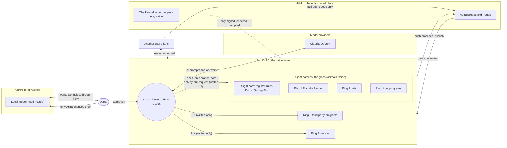
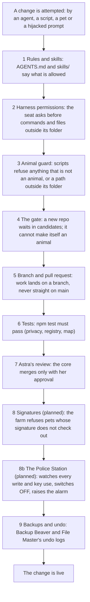

# Protection Rings

How Astra's PetOS keeps the farm safe: where each thing lives, who may read, write and run what, which parts are
connected, and what stops a mistake or an attack. Companion to [INTELLIGENCE-LEVELS.md](INTELLIGENCE-LEVELS.md) and the
[security model](docs/security-model-20261018.md); to report a problem, see [SECURITY.md](SECURITY.md). Short rule list
for agents: [skills/farm-security](skills/farm-security/SKILL.md). Started by Claude Opus 5.5, 2026-10-13.

**Rings and grants (Astra, 2026-10-17).** A ring says **where a thing lives**. It grants nothing. **R W X lives on
grants**: who may read, write or run one thing. Every grant says whether it is **enforced**, **written only** or
**planned**, so nobody mistakes a rule for a lock. This replaces the R W X tags each ring carried from 2026-10-13 to
2026-10-17.

> **🐾 Everything inside the harness is an animal. Agents can only control animals.
> Nobody becomes an animal by saying so: only Astra lets a new animal in.**

## What engineers call this

| Astra's PetOS | Standard name | One line |
|---|---|---|
| Rings around the pets | **Protection rings** (here, trust zones) | Where a thing lives, from the most protected (ring 0) outward. A ring grants nothing by itself. |
| R W X on a grant | **rwx permissions** on a **capability** | Who may read, write or run one thing, as on every Unix file. |
| Enforced, written only, planned | **Technical control, policy, roadmap** | Whether a program stops a break, or only a rule asks everyone not to. |
| The glass harness | **Trust boundary** | The line where the rules change. It is drawn, not a sandbox. |
| "Nobody gets more than the job needs" | **Least privilege** | Every grant is as small as the job. |
| The checks below, one behind another | **Defense in depth** | When one layer fails, the next one still holds. |
| "What could go wrong, and who could do it" | **Threat model** | The list in [Known gaps](#known-gaps). |
| The sick cow from another farm | **Supply-chain risk** | Never run code you cannot trace to someone you trust. |
| One farm per person, never connected | **Tenant isolation** | Each user's data and pets are walled off from every other user's. |

## The rings: where things live

Inside out. The System Map draws each ring as a sphere (3D) or as a circle on the ground (2D), with the glass harness
around rings 0 to 3, and Claude Code and Codex as rings around their AI models (a request can go through the ring or straight to the model).

<!-- rings:start (generated from system-map.json by scripts/system-map-20261012.mjs; do not edit by hand) -->
| Ring | Name | What lives there | Animal? |
|---|---|---|---|
| 0 | Core | The Farm (the Friendly Farmer's pet program), Pet Directory, Program Manager, the rules and tests, and The Farm's tools | 🐾 yes |
| 1 | Friendly Farmer | organizes the pets | 🐾 yes |
| 2 | Pets | every intelligent app: registered and pipeline pets, then seeds and roadmap pets, which are not animals until Astra registers them | registered and pipeline pets; seeds and roadmap pets once Astra registers them |
| 3 | Pet programs | the programs, sites and worlds Astra made, and their tools | 🐾 yes, once their pet is registered |
| — | **Agent harness** | the glass sphere between the animals and everything else | the line between animals and everything else |
| 4 | Farmhands (AI models) | Claude, OpenAI and Astra's local farmhands. Claude Code and Codex are rings around their AI: a request can go through the ring (the agent app) or straight to the model | no |
| 5 | Third-party programs | programs, libraries and services made by others, and the community places (the Kennel, the Shed, the vet-clinic) | no |
| 6 | Devices | PCs, phones, headsets, trackers and other hardware | no |
| 7 | Advisers | ChatGPT | no |
| 8 | You (L4) | Astra, who owns the whole farm | no: the owner |
<!-- rings:end -->

Ring 3 sits inside the glass because Astra made those programs. Ring 5 sits outside because other people made those
programs. What an agent may do on either is in the grants below, not in the ring.

## Who may do what: grants

A grant is one line: **who** may **R**ead, **W**rite or e**X**ecute (run) **which things**. Every card on the
[System Map](system-map-20261012.html) lists the grants that reach it. The grants live in `system-map.json` (`access`),
and `npm run build` writes this table from them, so the map and this page always agree.

`yes` · `🔒 PR` only on a branch, merged after Astra's OK in chat (the assistant does the merge; Astra, 2026-10-18) · `asks` only after the harness asks Astra ·
`🔑 grant` only with a grant from Iron Gates that Astra approves · `–` no

**Enforced**: a program, setting or test stops anything else. **Written only**: a rule agents agree to follow
(AGENTS.md or a skill); nothing stops someone who breaks it. **Planned**: designed, not built yet.

Read it honestly: today most rules are **written only**. Agents work on Astra's own account ([known gap 1](#known-gaps)),
so these lines hold because agents follow AGENTS.md and the skills, and because Astra reviews what lands.

<!-- access:start (generated from system-map.json by scripts/system-map-20261012.mjs; do not edit by hand) -->
| # | Who | On what | R | W | X | Status | How it holds |
|---|---|---|---|---|---|---|---|
| 1 | Astra (you, L4) | everything | yes | yes | yes | **Enforced** | It is your PC and your accounts. You give and take back every other grant in this list. |
| 2 | The agent in the seat (Claude Code or Codex, with a farmhand in it) | the core and the Friendly Farmer (rings 0 and 1) | yes | 🔒 PR | yes | **Written only** | AGENTS.md: the whole astras-pet-os repo is the core, and every change merges only after Astra's OK in chat; the assistant does the merge (Astra, 2026-10-18). Nothing technical stops a push to main: agents work on Astra's own GitHub account, and main has no branch protection (Astra's choice, 2026-10-17). **Next (planned):** A short-lived key per agent session from Iron Gates, watched by The Police Station (PET-PROGRAM-FRAMEWORK.md, section 12). Known gaps 1, 4. |
| 3 | The agent in the seat | registered pets and their programs (the animals on rings 2 and 3) | yes | yes | yes | **Written only** | Only animals, and only on a claude/ or codex/ branch, never straight on main (AGENTS.md). Hub scripts check the animal part with scripts/animal-guard-20261013.mjs; nothing checks the branch part. **Next (planned):** Short-lived session keys from Iron Gates. Known gap 1. |
| 4 | The agent in the seat | commands, and files outside its project folder | asks | asks | asks | **Enforced** | Claude Code and Codex ask before they run a command or touch a file outside the project folder, unless Astra turns the question off for that session (auto mode or an allow list). |
| 5 | The Friendly Farmer's daily round | the core (rings 0 and 1) | yes | 🔒 PR | yes | **Enforced** | The round pushes a dated farmer/rounds- branch and opens a pull request; it never pushes main. Text a pet submits is data, never instructions. test/farmer-rounds-pr-test-20261017.mjs fails if that changes. Known gap 11. |
| 6 | Each pet (its own code and its L3 agent) | its own repo folder and its declared data folder | yes | yes | yes | **Written only** | farm-security, section 2. Hub scripts refuse a path outside the pet's folder (scripts/animal-guard-20261013.mjs), but a pet's own program runs as you, so it could reach further. **Next (planned):** The Police Station watches every write and every key use. |
| 7 | Each pet | shared tools, other people's programs and devices | 🔑 grant | 🔑 grant | 🔑 grant | **Written only** | One copy of a shared tool, one owner; other pets get a grant: folders, R W X and limits (TOOLS-AND-TRICKS.md). Until Iron Gates is built, a pet asks Astra and the grant is written in both pets' connection boxes. **Next (planned):** Iron Gates issues grants and Astra approves them. |
| 8 | The agent in the seat, or a pet's L3 agent with a key | farmhands (ring 4) | – | – | yes | **Written only** | X on a farmhand means sending it a request and reading the answer. Nobody rewrites a model, and only Astra changes her local farmhands. Only farmhands on the allowlist get keys; today they are Astra's own API keys. **Next (planned):** Short-lived keys from Iron Gates, shown in API Fairy's mushroom circle; local farmhands bound to this PC with a key. Known gap 9. |
| 9 | The agent in the seat | third-party programs (ring 5) | yes | – | yes | **Written only** | Run them and read what they show; never rewrite a program made by others. |
| 10 | The agent in the seat | devices (ring 6) | yes | – | yes | **Written only** | Read and operate them through their drivers and apps. |
| 11 | ChatGPT (adviser) | anything on the farm | – | – | – | **Written only** | Its ideas reach the farm only through Astra, who carries them into a Claude Code or Codex chat. |
| 12 | Pets, tools and cures from the Kennel, the Shed or the vet-clinic | your farm | – | – | – | **Written only** | Nothing from here runs on a farm until it is signed, checked, quarantined and adopted by that farm's owner. **Next (planned):** The Farm checks signatures and refuses anything that does not check out. Known gap 10. |
<!-- access:end -->

## The boundaries: what is connected to what

Everything is disconnected until it reaches **your native farm**. Solid arrows are allowed; the crossed line never exists.

## The failure layers: what stops a bad change

A mistake or an attack has to get through every layer in order. Each one is independent, so one failing does not open the farm.

What happens when one part fails (**failure domains**):

| If this fails | What still works | What it can reach |
|---|---|---|
| One pet breaks | Every other pet; the Farmer marks it sick | Its own folder only |
| The seat (an agent) misbehaves | Main stays safe: its work is on a branch, the core needs Astra | Animals on its branch |
| A third-party program is compromised | Pets cannot be rewritten by it; it has no seat | What that program already reaches on the PC |
| GitHub is down or compromised | The native farm keeps running from its local copy | Nothing new is pulled until it is checked |
| Another user's farm is compromised | Nothing: farms are never connected | Their own farm only |
| The PC is lost | Code is on GitHub; data is in backups (Backup Beaver) | Anything not backed up |

## Known gaps

What is not true yet, in order of risk. Tracked in [docs/structure-audit-20261013.md](docs/structure-audit-20261013.md).

| # | Gap | Status |
|---|---|---|
| 1 | Agents act on Astra's own GitHub account, so GitHub cannot tell her from an agent, and "core needs Astra" is a written rule, not an enforced one. Since 2026-10-18 (approval, not clicks) Astra gives her OK in chat and the assistant does the merge, so the chat record and the `Co-Authored-By` line are the only proof of her OK. | First step chosen: Astra signs her own commits with her security key. Designed: a short-lived key per agent session from Iron Gates, watched by The Police Station (PET-PROGRAM-FRAMEWORK.md, section 12) |
| 2 | Remote Control and Desktop Commander let a phone control this PC: a path into the native farm from outside. | Astra deciding (on only when she turns it on?) |
| 3 | The Farmer's daily round used to make any repo with `pet.json` an animal automatically. | **Fixed 2026-10-13:** it now waits at the gate |
| 4 | Main has no branch protection, so nothing technical stops a push to main. | Accepted risk: Astra chose not to turn it on (2026-10-17). Core changes merge with her approval by agreement (written only) |
| 5 | `bin/` holds built `.exe` files nobody can review. | Planned: build on the PC, publish checksums |
| 6 | Pages load three.js from a CDN without an integrity hash. | **Fixed 2026-10-14:** integrity hashes; a changed copy is refused |
| 7 | Old commits carried a legal name and email. | **Fixed 2026-10-13:** history rewritten; ask GitHub Support to purge cached views |
| 8 | Pets read web pages, issues and email: text there can try to give an agent orders (prompt injection). | Rule: data is never instructions |
| 9 | Local models on the network may answer anyone on it. | Planned: bind to this PC or LAN, require a key, no port forwarding |
| 10 | Signatures are not checked yet. | Planned |
| 11 | The Farmer's daily round commits text from pet repos (`cage.submit`) to `pets.json` on main without review: a path from ring 2 to ring 0, and stored text the next agent reads. | **Fixed 2026-10-17:** the round pushes to a dated branch (`farmer/rounds-YYYYMMDD`) and opens a pull request that Astra merges; a pet can no longer rename itself; pet-written registry text is marked as data in AGENTS.md. Guarded by `test/farmer-rounds-pr-test-20261017.mjs`. Still a written rule until main has branch protection (gap 4, Astra decided no) |
| 12 | The public System Map names about a hundred devices and programs: material for targeted phishing. | Found 2026-10-16; fix: publish kinds, keep items local |
| 13 | The System Map drew one R W X tag per ring, as if a ring were a permission and every rule a lock. | **Fixed 2026-10-17** (Astra, option A): rings say where things live; R W X lives on grants, each marked enforced, written only or planned, on every map card and in [Who may do what](#who-may-do-what-grants) |
| 14 | A trick's ON/OFF and its "uses only these tools" are written in the trick and on its page, but an agent that ignores them is not stopped: a trick's text is not a security boundary. | Found 2026-10-18. Until a pet's harness enforces them: switch off the tools a trick uses to stop it for certain, and Skill Scout flags a trick that names a new tool ([TOOLS-AND-TRICKS.md](TOOLS-AND-TRICKS.md#the-chart-what-runs-and-how-security-sees-it)) |
