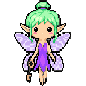

# Flash Audit rounds, 2026-10-17

One row per pet, in the order they were made. Tap a number for that pet's round card. Decisions waiting on you: [Flash Audit Answers](https://claude.ai/artifact/W6FMZthEzhj9EWxBgggCyc). What is going on right now: the [Pets Board](https://github.com/findastra/astras-pet-os/blob/board/BOARD.md).

| # | Pet | Program | Stage | Open | Fixed | Decisions | Pull requests | Card |
|--:|---|---|---|--:|--:|--:|---|---|
| 1 |  [Friendly Farmer](https://github.com/findastra/astras-pet-os) | [The Farm](https://findastra.github.io/astras-pet-os/apps/astras-pet-os-20261008.html) | registered | — | — | — | — | done 2026-10-14 (Codex) |
| 2 |  [GitHub Goldfish](https://github.com/findastra/github-goldfish) | [GitHub Aquarium](https://findastra.github.io/astras-pet-os/apps/github-goldfish-20261008.html) | registered | — | — | — | [github-goldfish#17](https://github.com/findastra/github-goldfish/pull/17) | done 2026-10-14 (Codex) |
| [3](round-03-data-dealer.md) |  [Chip](https://github.com/findastra/data-dealer) | [Data Dealer](https://findastra.github.io/astras-pet-os/apps/data-dealer-20261008.html) | registered | 10 | 4 | 2 | [data-dealer#2](https://github.com/findastra/data-dealer/pull/2) | [Round 3](round-03-data-dealer.md) |
| [4](round-04-api-fairy.md) |  [API Fairy](https://github.com/findastra/api-fairy) | [API Fairy Ring](https://findastra.github.io/astras-pet-os/apps/api-fairy-20261008.html) | registered | 7 | 3 | 0 | [api-fairy#1](https://github.com/findastra/api-fairy/pull/1) | [Round 4](round-04-api-fairy.md) |
| [5](round-05-unity-unicorn.md) |  [Unity Unicorn](https://github.com/findastra/unity-unicorn) | [Unity Stable](https://findastra.github.io/astras-pet-os/apps/unity-unicorn-20261008.html) | registered | 9 | 4 | 1 | [unity-unicorn#4](https://github.com/findastra/unity-unicorn/pull/4) | [Round 5](round-05-unity-unicorn.md) |
| [6](round-06-learn-python.md) |  [Python Panther](https://github.com/findastra/learn-python) | [Python Jungle](https://findastra.github.io/astras-pet-os/apps/learn-python-20261008.html) | registered | 10 | 5 | 0 | [learn-python#3](https://github.com/findastra/learn-python/pull/3) | [Round 6](round-06-learn-python.md) |
| [7](round-07-the-astral-plane.md) |  [Astra Wisp](https://github.com/findastra/the-astral-plane) | [The Astral Plane](https://findastra.github.io/astras-pet-os/apps/vrchat-ai-astra-20261008.html) | registered | 14 | 3 | 2 | [the-astral-plane#3](https://github.com/findastra/the-astral-plane/pull/3) | [Round 7](round-07-the-astral-plane.md) |
| [8](round-08-health-hummy.md) |  [Health Hummy](https://github.com/findastra/health-hummy) | [The Nectar Nest](https://findastra.github.io/astras-pet-os/apps/health-hummy-20261008.html) | registered | 7 | 4 | 0 | [health-hummy#2](https://github.com/findastra/health-hummy/pull/2) | [Round 8](round-08-health-hummy.md) |
| [9](round-09-finance-finch.md) |  [Finance Finch](https://github.com/findastra/finance-finch) | [Nest Egg](https://findastra.github.io/astras-pet-os/apps/finance-finch-20261008.html) | registered | 7 | 4 | 0 | [finance-finch#2](https://github.com/findastra/finance-finch/pull/2) | [Round 9](round-09-finance-finch.md) |
| [10](round-10-mommys-mommies.md) |  [Mommy's Mommies](https://github.com/findastra/mommys-mommies) | [Mommy’s Green Room](https://findastra.github.io/astras-pet-os/apps/mommys-20261008.html) | registered | 11 | 4 | 0 | [mommys-mommies#2](https://github.com/findastra/mommys-mommies/pull/2) | [Round 10](round-10-mommys-mommies.md) |
| [11](round-11-paper-girl.md) |  [Paper Girl Patty](https://github.com/findastra/paper-girl) | [Paper Girl](https://findastra.github.io/paper-girl/) | registered | 9 | 6 | 0 | [paper-girl#1](https://github.com/findastra/paper-girl/pull/1) | [Round 11](round-11-paper-girl.md) |
| [12](round-12-file-master.md) |  [File Master](https://github.com/findastra/file-master) | [File Kingdom](https://findastra.github.io/astras-pet-os/apps/file-master-20261008.html) | registered | 9 | 4 | 1 | [file-master#5](https://github.com/findastra/file-master/pull/5) | [Round 12](round-12-file-master.md) |
| [13](round-13-findastra-discord-presence.md) |  [Discord Damsel](https://github.com/findastra/findastra-discord-presence) | [Discord Tower](https://findastra.github.io/astras-pet-os/apps/findastra-discord-presence-20261008.html) | registered | 11 | 5 | 1 | [findastra-discord-presence#3](https://github.com/findastra/findastra-discord-presence/pull/3) | [Round 13](round-13-findastra-discord-presence.md) |
| [14](round-14-portfolio-puffer.md) |  [Portfolio Puffer](https://github.com/findastra/portfolio-puffer) | [Iced Out Iceberg](https://findastra.github.io/astras-pet-os/apps/portfolio-puffer-20261008.html) | registered | 7 | 4 | 0 | [portfolio-puffer#2](https://github.com/findastra/portfolio-puffer/pull/2) | [Round 14](round-14-portfolio-puffer.md) |
| [15](round-15-drum-dog.md) |  [Drum Dog](https://github.com/findastra/drum-dog) | [Bass & Biscuits](https://findastra.github.io/astras-pet-os/apps/drum-dog-20261008.html) | registered | 8 | 4 | 0 | [drum-dog#2](https://github.com/findastra/drum-dog/pull/2) | [Round 15](round-15-drum-dog.md) |
| [16](round-16-vscode-angel.md) |  [VSCode Angel](https://github.com/findastra/vscode-angel) | [Halo List](https://findastra.github.io/astras-pet-os/apps/vscode-angel-20261008.html) | registered | 9 | 4 | 1 | [vscode-angel#2](https://github.com/findastra/vscode-angel/pull/2) | [Round 16](round-16-vscode-angel.md) |
| [17](round-17-ghost-protocol.md) |  [Gone Ghost](https://github.com/findastra/ghost-protocol) | [Am I a Ghost?](https://findastra.github.io/ghost-protocol/) | registered | 9 | 5 | 0 | [ghost-protocol#4](https://github.com/findastra/ghost-protocol/pull/4) | [Round 17](round-17-ghost-protocol.md) |
| [18](round-18-project-parrot.md) |  [Project Parrot](https://github.com/findastra/project-parrot) | [Idea Perch](https://findastra.github.io/astras-pet-os/apps/project-parrot-20261008.html) | registered | 8 | 3 | 0 | [project-parrot#2](https://github.com/findastra/project-parrot/pull/2) | [Round 18](round-18-project-parrot.md) |
| [19](round-19-voicemeeter-bug.md) |  [Voicemeeter Bug](https://github.com/findastra/voicemeeter-bug) | [Audio Rescue](https://findastra.github.io/astras-pet-os/apps/voicemeeter-bug-20261008.html) | registered | 9 | 2 | 1 | [voicemeeter-bug#1](https://github.com/findastra/voicemeeter-bug/pull/1) | [Round 19](round-19-voicemeeter-bug.md) |
| [20](round-20-spoonfed.md) |  [Sugarcube](https://github.com/findastra/spoonfed) | [Spoonfed](https://github.com/findastra/spoonfed) | pipeline | 6 | 2 | 2 | [spoonfed#1](https://github.com/findastra/spoonfed/pull/1) | [Round 20](round-20-spoonfed.md) |
| [21](round-21-claude-bot.md) |  [Claude Bot](https://github.com/findastra/claude-bot) | [Claude Dock](https://github.com/findastra/claude-bot) | pipeline | 7 | 4 | 0 | [claude-bot#1](https://github.com/findastra/claude-bot/pull/1) | [Round 21](round-21-claude-bot.md) |
| [22](round-22-rgbee.md) |  [RGBee](https://github.com/findastra/rgbee) | [Light Hive](https://github.com/findastra/rgbee) | pipeline | 8 | 3 | 0 | [rgbee#2](https://github.com/findastra/rgbee/pull/2) | [Round 22](round-22-rgbee.md) |
| [23](round-23-mine-mole.md) |  [Mine Mole](https://github.com/findastra/mine-mole) | [Crypto Burrow](https://github.com/findastra/mine-mole) | pipeline | 10 | 6 | 1 | [mine-mole#2](https://github.com/findastra/mine-mole/pull/2) | [Round 23](round-23-mine-mole.md) |
| [24](round-24-mail-snail.md) |  [Mail Snail](https://github.com/findastra/mail-snail) | [Mail Shell](https://github.com/findastra/mail-snail) | pipeline | 9 | 3 | 2 | [mail-snail#2](https://github.com/findastra/mail-snail/pull/2) | [Round 24](round-24-mail-snail.md) |
| [25](round-25-patch-cat.md) |  [Patch Cat](https://github.com/findastra/patch-cat) | [The Litter Box](https://github.com/findastra/patch-cat) | pipeline | 8 | 3 | 1 | [patch-cat#2](https://github.com/findastra/patch-cat/pull/2) | [Round 25](round-25-patch-cat.md) |
| [26](round-26-meme-fiend.md) |  [Meme Fiend](https://github.com/findastra/meme-fiend) | [Cursed Archive](https://github.com/findastra/meme-fiend) | pipeline | 7 | 4 | 0 | [meme-fiend#2](https://github.com/findastra/meme-fiend/pull/2) | [Round 26](round-26-meme-fiend.md) |
| [27](round-27-astras-gif-maker.md) |  [Gif Giraffe](https://github.com/findastra/astras-gif-maker) | [Astra's GIF Maker](https://github.com/findastra/astras-gif-maker) | pipeline | 8 | 2 | 0 | [astras-gif-maker#1](https://github.com/findastra/astras-gif-maker/pull/1) | [Round 27](round-27-astras-gif-maker.md) |
| [28](round-28-backup-beaver.md) |  [Backup Beaver](https://github.com/findastra/backup-beaver) | [Backup Dam](https://github.com/findastra/backup-beaver) | pipeline | 7 | 4 | 0 | [backup-beaver#2](https://github.com/findastra/backup-beaver/pull/2) | [Round 28](round-28-backup-beaver.md) |
| [29](round-29-rift-rabbit.md) |  [Rift Rabbit](https://github.com/findastra/rift-rabbit) | [Wonderland Launchpad](https://github.com/findastra/rift-rabbit) | pipeline | 9 | 3 | 1 | [rift-rabbit#2](https://github.com/findastra/rift-rabbit/pull/2) | [Round 29](round-29-rift-rabbit.md) |
| [30](round-30-fuzzboi-friend.md) |  [Fuzzboi Friend](https://github.com/findastra/fuzzboi-friend) | [Fuzzboi Factory](https://github.com/findastra/fuzzboi-friend) | pipeline | 8 | 4 | 0 | [fuzzboi-friend#2](https://github.com/findastra/fuzzboi-friend/pull/2) | [Round 30](round-30-fuzzboi-friend.md) |
| [31](round-31-wifi-butterfly.md) |  [Wifi Butterfly](https://github.com/findastra/wifi-butterfly) | [Signal Garden](https://github.com/findastra/wifi-butterfly) | pipeline | 6 | 3 | 0 | [wifi-butterfly#2](https://github.com/findastra/wifi-butterfly/pull/2) | [Round 31](round-31-wifi-butterfly.md) |
| [32](round-32-deck-duck.md) |  [Deck Duck](https://github.com/findastra/deck-duck) | [Deck Pond](https://github.com/findastra/deck-duck) | pipeline | 9 | 4 | 1 | [deck-duck#2](https://github.com/findastra/deck-duck/pull/2) | [Round 32](round-32-deck-duck.md) |
| [33](round-33-mesh-moth.md) |  [Mesh Moth](https://github.com/findastra/mesh-moth) | [Mesh Lantern](https://github.com/findastra/mesh-moth) | pipeline | 8 | 4 | 0 | [mesh-moth#2](https://github.com/findastra/mesh-moth/pull/2) | [Round 33](round-33-mesh-moth.md) |
| [34](round-34-raspberry-berry.md) |  [Raspberry Pi Berry](https://github.com/findastra/raspberry-berry) | [Raspberry Pi Maker](https://github.com/findastra/raspberry-berry) | pipeline | 11 | 2 | 1 | [raspberry-berry#3](https://github.com/findastra/raspberry-berry/pull/3) | [Round 34](round-34-raspberry-berry.md) |
| [35](round-35-chat-rat.md) |  [Chat Rat](https://github.com/findastra/chat-rat) | [Chat Stack](https://github.com/findastra/chat-rat) | pipeline | 10 | 3 | 1 | [chat-rat#5](https://github.com/findastra/chat-rat/pull/5) | [Round 35](round-35-chat-rat.md) |
| [36](round-36-platform-platypus.md) |  [Platform Platypus](https://github.com/findastra/platform-platypus) | [Mirror Pool](https://findastra.github.io/platform-platypus/) | registered | 8 | 0 | 0 | — | [Round 36](round-36-platform-platypus.md) |
| [37](round-37-pet-program-37.md) | [Dubstep Gunsmith](https://github.com/findastra/pet-program-37) | [Dubstep Armory](https://github.com/findastra/pet-program-37) | seed | 2 | 2 | 0 | [pet-program-37#1](https://github.com/findastra/pet-program-37/pull/1) | [Round 37](round-37-pet-program-37.md) |
| [38](round-38-pet-program-38.md) |  [Pole Puff](https://github.com/findastra/pet-program-38) | [Infinite Studio](https://github.com/findastra/pet-program-38) | seed | 3 | 2 | 0 | [pet-program-38#1](https://github.com/findastra/pet-program-38/pull/1) | [Round 38](round-38-pet-program-38.md) |
| [39](round-39-pet-program-39.md) |  [Procreate Panda](https://github.com/findastra/pet-program-39) | [Bamboo Studio](https://github.com/findastra/pet-program-39) | seed | 3 | 2 | 0 | [pet-program-39#1](https://github.com/findastra/pet-program-39/pull/1) | [Round 39](round-39-pet-program-39.md) |
| [40](round-40-pet-program-40.md) |  [Skill Scout](https://github.com/findastra/pet-program-40) | [Luna's Log](https://github.com/findastra/pet-program-40) | seed | 4 | 2 | 0 | [pet-program-40#1](https://github.com/findastra/pet-program-40/pull/1) | [Round 40](round-40-pet-program-40.md) |
| [41](round-41-pet-program-41.md) |  [OSC Sealion](https://github.com/findastra/pet-program-41) | [OSC Sonar](https://github.com/findastra/pet-program-41) | seed | 3 | 2 | 0 | [pet-program-41#1](https://github.com/findastra/pet-program-41/pull/1) | [Round 41](round-41-pet-program-41.md) |
| [42](round-42-pet-program-42.md) |  [Piranesi Nessi](https://github.com/findastra/pet-program-42) | [Nessi's Ocean](https://github.com/findastra/pet-program-42) | seed | 3 | 2 | 0 | [pet-program-42#1](https://github.com/findastra/pet-program-42/pull/1) | [Round 42](round-42-pet-program-42.md) |
| [43](round-43-pet-program-43.md) |  [Photo Dodo](https://github.com/findastra/pet-program-43) | [Photo Roost](https://github.com/findastra/pet-program-43) | seed | 3 | 2 | 0 | [pet-program-43#1](https://github.com/findastra/pet-program-43/pull/1) | [Round 43](round-43-pet-program-43.md) |
| [44](round-44-pet-program-44.md) |  [Video Vulture](https://github.com/findastra/pet-program-44) | [Video Vault](https://github.com/findastra/pet-program-44) | seed | 3 | 2 | 0 | [pet-program-44#1](https://github.com/findastra/pet-program-44/pull/1) | [Round 44](round-44-pet-program-44.md) |
| [45](round-45-the-cats-closet.md) |  [Closet Cat](https://github.com/findastra/the-cats-closet) | [The Cat's Closet](https://github.com/findastra/the-cats-closet) | seed | 3 | 2 | 0 | [the-cats-closet#1](https://github.com/findastra/the-cats-closet/pull/1) | [Round 45](round-45-the-cats-closet.md) |
| [46](round-46-iron-gates.md) | [Gatekeeper Goddess](https://github.com/findastra/iron-gates) | [Iron Gates](https://github.com/findastra/iron-gates) | roadmap | 2 | 2 | 0 | [iron-gates#1](https://github.com/findastra/iron-gates/pull/1) | [Round 46](round-46-iron-gates.md) |
| [47](round-47-pet-program-47.md) | [Queue Quokka](https://github.com/findastra/pet-program-47) | [Task Island](https://github.com/findastra/pet-program-47) | roadmap | 2 | 2 | 0 | [pet-program-47#1](https://github.com/findastra/pet-program-47/pull/1) | [Round 47](round-47-pet-program-47.md) |
| [48](round-48-pet-program-48.md) | [Log Lynx](https://github.com/findastra/pet-program-48) | [Log Den](https://github.com/findastra/pet-program-48) | roadmap | 2 | 2 | 0 | [pet-program-48#1](https://github.com/findastra/pet-program-48/pull/1) | [Round 48](round-48-pet-program-48.md) |
| [49](round-49-pet-program-49.md) | [Server Salamander](https://github.com/findastra/pet-program-49) | [Server Hearth](https://github.com/findastra/pet-program-49) | roadmap | 2 | 2 | 0 | [pet-program-49#1](https://github.com/findastra/pet-program-49/pull/1) | [Round 49](round-49-pet-program-49.md) |
| [50](round-50-pet-program-50.md) | [Docker Dragon](https://github.com/findastra/pet-program-50) | [Container Hoard](https://github.com/findastra/pet-program-50) | roadmap | 2 | 2 | 0 | [pet-program-50#1](https://github.com/findastra/pet-program-50/pull/1) | [Round 50](round-50-pet-program-50.md) |
| [51](round-51-pet-program-51.md) | [Test Tortoise](https://github.com/findastra/pet-program-51) | [Test Track](https://github.com/findastra/pet-program-51) | roadmap | 2 | 2 | 0 | [pet-program-51#1](https://github.com/findastra/pet-program-51/pull/1) | [Round 51](round-51-pet-program-51.md) |
| [52](round-52-pet-program-52.md) | [Token Toucan](https://github.com/findastra/pet-program-52) | [Token Canopy](https://github.com/findastra/pet-program-52) | roadmap | 2 | 2 | 0 | [pet-program-52#1](https://github.com/findastra/pet-program-52/pull/1) | [Round 52](round-52-pet-program-52.md) |
| [53](round-53-pet-program-53.md) | [Packet Piranha](https://github.com/findastra/pet-program-53) | [Packet River](https://github.com/findastra/pet-program-53) | roadmap | 2 | 2 | 0 | [pet-program-53#1](https://github.com/findastra/pet-program-53/pull/1) | [Round 53](round-53-pet-program-53.md) |
| [54](round-54-pet-program-54.md) | [Calendar Crow](https://github.com/findastra/pet-program-54) | [Crow's Nest](https://github.com/findastra/pet-program-54) | roadmap | 2 | 2 | 0 | [pet-program-54#1](https://github.com/findastra/pet-program-54/pull/1) | [Round 54](round-54-pet-program-54.md) |
| [55](round-55-pet-program-55.md) | [Browser Bat](https://github.com/findastra/pet-program-55) | [Browser Belfry](https://github.com/findastra/pet-program-55) | roadmap | 2 | 2 | 0 | [pet-program-55#1](https://github.com/findastra/pet-program-55/pull/1) | [Round 55](round-55-pet-program-55.md) |
| [56](round-56-pet-program-56.md) | [Data Dragonfly](https://github.com/findastra/pet-program-56) | [Data Marsh](https://github.com/findastra/pet-program-56) | roadmap | 2 | 2 | 0 | [pet-program-56#1](https://github.com/findastra/pet-program-56/pull/1) | [Round 56](round-56-pet-program-56.md) |
| [57](round-57-pet-program-57.md) | [Update Urchin](https://github.com/findastra/pet-program-57) | [Update Tidepool](https://github.com/findastra/pet-program-57) | roadmap | 2 | 2 | 0 | [pet-program-57#1](https://github.com/findastra/pet-program-57/pull/1) | [Round 57](round-57-pet-program-57.md) |
| [58](round-58-pet-program-58.md) | [Linux Penguin](https://github.com/findastra/pet-program-58) | [Linux Iceberg](https://github.com/findastra/pet-program-58) | roadmap | 2 | 2 | 0 | [pet-program-58#1](https://github.com/findastra/pet-program-58/pull/1) | [Round 58](round-58-pet-program-58.md) |
| [59](round-59-pet-program-59.md) | [Stock Fox](https://github.com/findastra/pet-program-59) | [Market Meadow](https://github.com/findastra/pet-program-59) | roadmap | 2 | 2 | 0 | [pet-program-59#1](https://github.com/findastra/pet-program-59/pull/1) | [Round 59](round-59-pet-program-59.md) |
| [60](round-60-pet-program-60.md) | [Passport Pelican](https://github.com/findastra/pet-program-60) | [Passport Harbor](https://github.com/findastra/pet-program-60) | roadmap | 2 | 2 | 0 | [pet-program-60#1](https://github.com/findastra/pet-program-60/pull/1) | [Round 60](round-60-pet-program-60.md) |
| [61](round-61-pet-program-61.md) | [Journal Jellyfish](https://github.com/findastra/pet-program-61) | [Journal Lagoon](https://github.com/findastra/pet-program-61) | roadmap | 2 | 2 | 0 | [pet-program-61#1](https://github.com/findastra/pet-program-61/pull/1) | [Round 61](round-61-pet-program-61.md) |
| [62](round-62-pet-program-62.md) | [Shell Squid](https://github.com/findastra/pet-program-62) | [Shell Trench](https://github.com/findastra/pet-program-62) | roadmap | 2 | 2 | 0 | [pet-program-62#1](https://github.com/findastra/pet-program-62/pull/1) | [Round 62](round-62-pet-program-62.md) |
| [63](round-63-pet-program-63.md) | [Kernel Koala](https://github.com/findastra/pet-program-63) | [Kernel Grove](https://github.com/findastra/pet-program-63) | roadmap | 2 | 2 | 0 | [pet-program-63#1](https://github.com/findastra/pet-program-63/pull/1) | [Round 63](round-63-pet-program-63.md) |
| [64](round-64-pet-program-64.md) | [Proxy Axolotl](https://github.com/findastra/pet-program-64) | [Proxy Lake](https://github.com/findastra/pet-program-64) | roadmap | 2 | 2 | 0 | [pet-program-64#1](https://github.com/findastra/pet-program-64/pull/1) | [Round 64](round-64-pet-program-64.md) |
| [65](round-65-pet-program-65.md) | [Cluster Crab](https://github.com/findastra/pet-program-65) | [Cluster Shore](https://github.com/findastra/pet-program-65) | roadmap | 2 | 2 | 0 | [pet-program-65#1](https://github.com/findastra/pet-program-65/pull/1) | [Round 65](round-65-pet-program-65.md) |
| [66](round-66-pet-program-66.md) | [Storage Stoat](https://github.com/findastra/pet-program-66) | [Storage Warren](https://github.com/findastra/pet-program-66) | roadmap | 2 | 2 | 0 | [pet-program-66#1](https://github.com/findastra/pet-program-66/pull/1) | [Round 66](round-66-pet-program-66.md) |
| [67](round-67-pet-program-67.md) | [White Hat Weasel](https://github.com/findastra/pet-program-67) | [White Hat Lab](https://github.com/findastra/pet-program-67) | roadmap | 2 | 2 | 0 | [pet-program-67#1](https://github.com/findastra/pet-program-67/pull/1) | [Round 67](round-67-pet-program-67.md) |
| [68](round-68-pet-program-68.md) | [Port Spider](https://github.com/findastra/pet-program-68) | [Port Web](https://github.com/findastra/pet-program-68) | roadmap | 2 | 2 | 0 | [pet-program-68#1](https://github.com/findastra/pet-program-68/pull/1) | [Round 68](round-68-pet-program-68.md) |
| [69](round-69-pet-program-69.md) | [Cipher Owl](https://github.com/findastra/pet-program-69) | [Cipher Hollow](https://github.com/findastra/pet-program-69) | roadmap | 2 | 2 | 0 | [pet-program-69#1](https://github.com/findastra/pet-program-69/pull/1) | [Round 69](round-69-pet-program-69.md) |
| [70](round-70-pet-program-70.md) | [Forensic Ferret](https://github.com/findastra/pet-program-70) | [Evidence Locker](https://github.com/findastra/pet-program-70) | roadmap | 2 | 2 | 0 | [pet-program-70#1](https://github.com/findastra/pet-program-70/pull/1) | [Round 70](round-70-pet-program-70.md) |
| [71](round-71-pet-program-71.md) | [Llama Librarian](https://github.com/findastra/pet-program-71) | [Model Library](https://github.com/findastra/pet-program-71) | roadmap | 2 | 2 | 0 | [pet-program-71#1](https://github.com/findastra/pet-program-71/pull/1) | [Round 71](round-71-pet-program-71.md) |
| [72](round-72-pet-program-72.md) | [Inference Iguana](https://github.com/findastra/pet-program-72) | [Benchmark Rock](https://github.com/findastra/pet-program-72) | roadmap | 2 | 2 | 0 | [pet-program-72#1](https://github.com/findastra/pet-program-72/pull/1) | [Round 72](round-72-pet-program-72.md) |
| [73](round-73-pet-program-73.md) | [Agent Ant](https://github.com/findastra/pet-program-73) | [Agent Colony](https://github.com/findastra/pet-program-73) | roadmap | 2 | 2 | 0 | [pet-program-73#1](https://github.com/findastra/pet-program-73/pull/1) | [Round 73](round-73-pet-program-73.md) |
| [74](round-74-pet-program-74.md) | [Roaming Raven](https://github.com/findastra/pet-program-74) | [Roam Map](https://github.com/findastra/pet-program-74) | roadmap | 2 | 2 | 0 | [pet-program-74#1](https://github.com/findastra/pet-program-74/pull/1) | [Round 74](round-74-pet-program-74.md) |
| [75](round-75-pet-program-75.md) | [Cache Coyote](https://github.com/findastra/pet-program-75) | [Cache Canyon](https://github.com/findastra/pet-program-75) | roadmap | 2 | 2 | 0 | [pet-program-75#1](https://github.com/findastra/pet-program-75/pull/1) | [Round 75](round-75-pet-program-75.md) |
| [76](round-76-pet-program-76.md) | [Sync Mink](https://github.com/findastra/pet-program-76) | [Sync Stream](https://github.com/findastra/pet-program-76) | roadmap | 2 | 2 | 0 | [pet-program-76#1](https://github.com/findastra/pet-program-76/pull/1) | [Round 76](round-76-pet-program-76.md) |
| [77](round-77-pet-program-77.md) | [Triage Tapir](https://github.com/findastra/pet-program-77) | [The Triage Desk](https://github.com/findastra/pet-program-77) | seed | 2 | 2 | 0 | [pet-program-77#1](https://github.com/findastra/pet-program-77/pull/1) | [Round 77](round-77-pet-program-77.md) |
| [78](round-78-the-police-station.md) | [Pet Police Officer](https://github.com/findastra/the-police-station) | [The Police Station](https://github.com/findastra/the-police-station) | seed | 3 | 2 | 0 | [the-police-station#1](https://github.com/findastra/the-police-station/pull/1) | [Round 78](round-78-the-police-station.md) |
| [79](round-79-ai-doghouse.md) | [AI Dashund](https://github.com/findastra/ai-doghouse) | [AI Doghouse](https://github.com/findastra/ai-doghouse) | seed | 2 | 2 | 0 | [ai-doghouse#1](https://github.com/findastra/ai-doghouse/pull/1) | [Round 79](round-79-ai-doghouse.md) |
| [80](round-80-the-recovery-room.md) | [Rescue Retriever](https://github.com/findastra/the-recovery-room) | [The Recovery Room](https://github.com/findastra/the-recovery-room) | seed | 3 | 2 | 0 | [the-recovery-room#1](https://github.com/findastra/the-recovery-room/pull/1) | [Round 80](round-80-the-recovery-room.md) |
| [81](round-81-pet-program-81.md) | [Intel Owl](https://github.com/findastra/pet-program-81) | [Threat Observatory](https://github.com/findastra/pet-program-81) | seed | 3 | 0 | 1 | [pet-program-81#1](https://github.com/findastra/pet-program-81/pull/1) | [Round 81](round-81-pet-program-81.md) |
| [82](round-82-the-threshold.md) | [Door Dormouse](https://github.com/findastra/the-threshold) | [The Threshold](https://github.com/findastra/the-threshold) | seed | 3 | 0 | 1 | [the-threshold#1](https://github.com/findastra/the-threshold/pull/1) | [Round 82](round-82-the-threshold.md) |
| [83](round-83-role-fairy.md) | [Role Fairy](https://github.com/findastra/role-fairy) | [Fairy Ring](https://github.com/findastra/role-fairy) | pipeline | 9 | 4 | 1 | [role-fairy#1](https://github.com/findastra/role-fairy/pull/1) | [Round 83](round-83-role-fairy.md) |

**Open**: still to do after the pull requests merge. **Fixed**: what they fix. The order is the pet list in [findastra's profile README](https://github.com/findastra/findastra#readme).

Idle Flash Audit, 2026-10-17, Claude Opus 5.5 (`claude-opus-5-5`). Built by `scripts/idle-flash-cards-20261017.mjs` from the evidence ledger in this folder.
