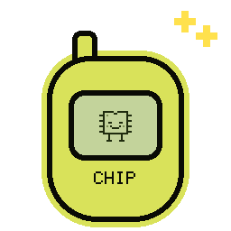
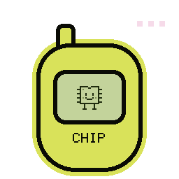
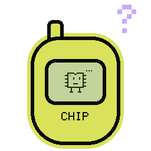
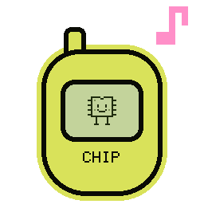
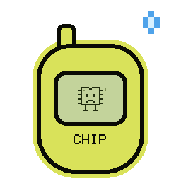
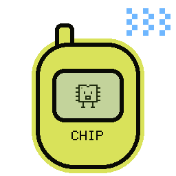
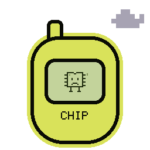

# Round 3: Chip — Data Dealer

[All rounds](README.md) · Stage: **registered** · Repo: [findastra/data-dealer](https://github.com/findastra/data-dealer) (public) · audited `main` at `19166ca`

| Sleepy | Awake | Idle | Curious | Happy | Worried | Alarmed | Sick | Sad |
|:-:|:-:|:-:|:-:|:-:|:-:|:-:|:-:|:-:|
|  |  |  |  |  |  |  |  |  |

### Exceptions

⚪ the Idle Flash Audit fixes it (a fix in code is named for the pet's chat) · 🔵 waits for your Active Flash Session

1. ⚪ **A15 README and credit** — Missing. README has no Limits section.  
   *Next:* This README is the product's own, so tonight only names and links changed in it. Add a Limits section there?
2. ⚪ **A16 pet.json** — Missing. Metadata: framework declaration  
   *Next:* Framework metadata comes with the shared page framework (Codex's branch); not added by hand tonight.
3. ⚪ **A55 Pictures** — Missing. README shows 1 picture(s).  
   *Next:* Needs real pictures of the program working (you take some: card 026).
4. 🔵 **A18 Tool list** — Missing. No declared tool inventory.  
   *Next:* No tool list yet. It comes with the shared page framework.
5. ⚪ **A52 L3 activity bubble** — On a branch. Required shared L3 activity bubble/config/script/style not found in the inspected entry source.  
   *Next:* It is built on unmerged branch `codex/l3-activity-20261016` ([compare](https://github.com/findastra/data-dealer/compare/main...codex/l3-activity-20261016)): merging that branch passes this.
6. ⚪ **A44 Yellow phone** — On a branch. Shared phone baseline not found.  
   *Next:* It is built on unmerged branch `codex/l3-activity-20261016` ([compare](https://github.com/findastra/data-dealer/compare/main...codex/l3-activity-20261016)): merging that branch passes this.
7. ⚪ **A45 Paper and zoom** — On a branch. Shared stationery source not found.  
   *Next:* It is built on unmerged branch `codex/l3-activity-20261016` ([compare](https://github.com/findastra/data-dealer/compare/main...codex/l3-activity-20261016)): merging that branch passes this.
8. ⚪ **A41 Clicker Training** — On a branch. No Clicker Training section found in the inspected entry source.  
   *Next:* It is built on unmerged branch `codex/l3-activity-20261016` ([compare](https://github.com/findastra/data-dealer/compare/main...codex/l3-activity-20261016)): merging that branch passes this.

### Decisions

1. 🔵 **pets.json says Chip is private, but GitHub says public.** Change the repo, or keep it and update the registry?

**Tools:** none declared in pet.json yet (A18).  
**Tutorial tools:** Play with, Care for — Not verified overnight.

Idle Flash Audit, 2026-10-18, Claude Opus 5.5. Read-only checks through the GitHub API; nothing was clicked, launched or signed in to.
