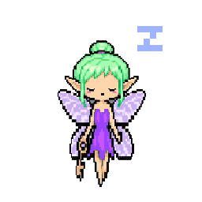
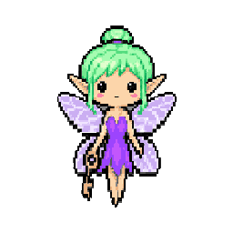
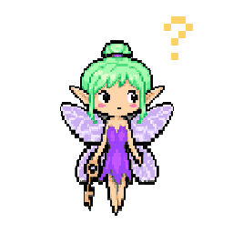
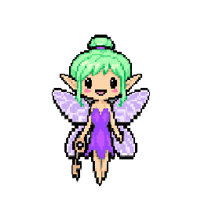
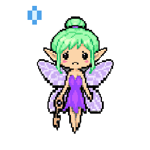
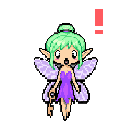
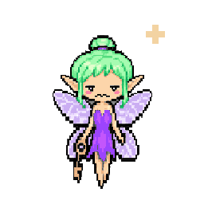
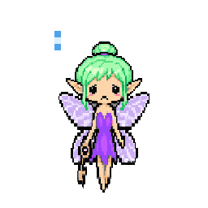

# Round 4: API Fairy — API Fairy Ring

[All rounds](README.md) · Stage: **registered** · Repo: [findastra/api-fairy](https://github.com/findastra/api-fairy) (public) · audited `main` at `36a2924`

| Sleepy | Awake | Idle | Curious | Happy | Worried | Alarmed | Sick | Sad |
|:-:|:-:|:-:|:-:|:-:|:-:|:-:|:-:|:-:|
|  |  |  |  |  |  |  |  |  |

### Exceptions

⚪ the Idle Flash Audit fixes it (a fix in code is named for the pet's chat) · 🔵 waits for your Active Flash Session

1. ⚪ **A57 Current names only** — Incorrect. Retired names (the old hub names, findastra-pet-apps, Documents\Projects) in `README.md`, `api-fairy-20261008.html`, `src/Snapshot.cs`, `tests/Tests.cs`.  
   *Next:* A line that tells history, a file name, or a name inside the page's script (a storage key), so it was kept; anything else here is for the pet's chat.
2. ⚪ **A17 Git branches** — Incorrect. 2 branch(es) with work not on main and no open pull request: claude/girls-same-size-20261017 (+5), claude/one-art-source-20261017 (+4).  
   *Next:* See Decisions: open a pull request, merge, or leave each branch.
3. ⚪ **A55 Pictures** — Missing. README shows 1 picture(s).  
   *Next:* Needs real pictures of the program working (you take some: card 026).
4. 🔵 **A18 Tool list** — Missing. No declared tool inventory.  
   *Next:* No tool list yet. It comes with the shared page framework.
5. 🔵 **A52 L3 activity bubble** — Not verified. Shared L3 activity source exists. Observe a real task, provider/session, timestamps, disconnect, OFF, stale feed and desktop/mobile rendering before passing.  
   *Next:* Comes with Codex's shared page framework: card 035 asks Codex to bring its pull requests up to date.
6. ⚪ **A44 Yellow phone** — Not verified. Shared phone source exists; inspect rendered chat and host behavior.  
   *Next:* Comes with Codex's shared page framework: card 035 asks Codex to bring its pull requests up to date.
7. ⚪ **A45 Paper and zoom** — Not verified. Paper/zoom source exists; browser viewport acceptance is separate.  
   *Next:* Comes with Codex's shared page framework: card 035 asks Codex to bring its pull requests up to date.
8. ⚪ **A41 Clicker Training** — Not verified. Training source exists; desktop click timing and actions need live verification.  
   *Next:* Comes with Codex's shared page framework: card 035 asks Codex to bring its pull requests up to date.

### Decisions

1. 🔵 **Branches with work not on main** and no pull request: [`claude/girls-same-size-20261017`](https://github.com/findastra/api-fairy/compare/main...claude%2Fgirls-same-size-20261017) (+5), [`claude/one-art-source-20261017`](https://github.com/findastra/api-fairy/compare/main...claude%2Fone-art-source-20261017) (+4). Open a PR, merge, or leave?

**Tools:** none declared in pet.json yet (A18).  
**Tutorial tools:** Play with, Care for — Not verified overnight.

Idle Flash Audit, 2026-10-18, Claude Opus 5.5. Read-only checks through the GitHub API; nothing was clicked, launched or signed in to.
