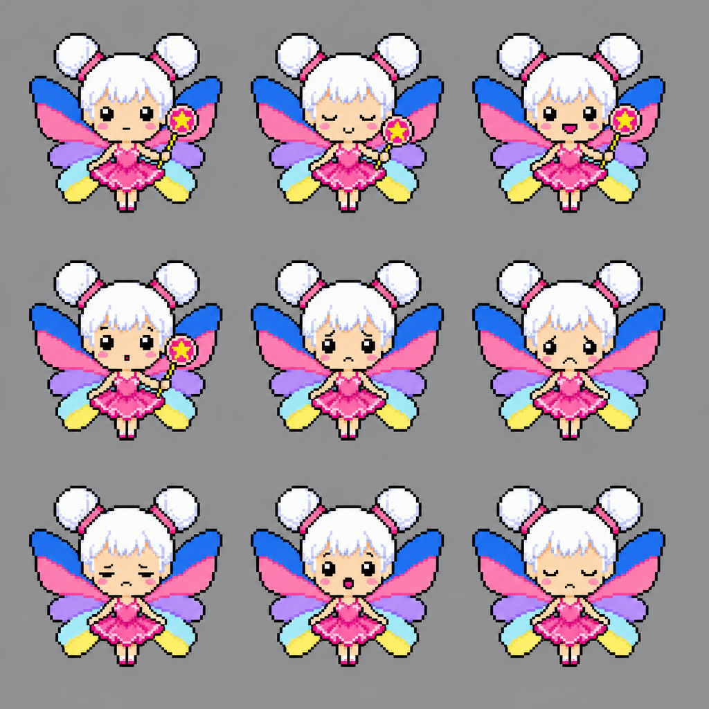

# Round 83: Role Fairy — Fairy Ring

[All rounds](README.md) · Stage: **pipeline** · Repo: [findastra/role-fairy](https://github.com/findastra/role-fairy) (public) · audited `main` at `8f0bb1c`

*Icon: Missing*

 *Draft seed sheet (not approved art; no frames in the hub yet).*

### Exceptions

⚪ the Idle Flash Audit fixes it (a fix in code is named for the pet's chat) · 🔵 waits for your Active Flash Session

1. 🔵 **A01 Icon** — Missing. No icon in astras-pet-os art/icons.  
   *Next:* Needs pet art. Generating art costs money, so it waits for your OK.
2. ⚪ **A15 README and credit** — Incorrect. README title "Mommy’s Role Fairy" is neither the repo name in Title Case ("Role Fairy") nor the pet name.  
   *Next:* The title is a naming choice, so it was left alone. Rename the heading?
3. ⚪ **A16 pet.json** — Missing. Metadata: sprite target, framework declaration  
   *Next:* Framework metadata comes with the shared page framework (Codex's branch); not added by hand tonight.
4. ⚪ **A55 Pictures** — Missing. README shows 0 picture(s).  
   *Next:* Needs real pictures of the program working (you take some: card 026).
5. 🔵 **A18 Tool list** — Missing. No declared tool inventory.  
   *Next:* No tool list yet. It comes with the shared page framework.
6. ⚪ **A52 L3 activity bubble** — Missing. Required shared L3 activity bubble/config/script/style not found in the inspected entry source.  
   *Next:* Comes with Codex's shared page framework: card 035 asks Codex to bring its pull requests up to date.
7. ⚪ **A44 Yellow phone** — Missing. Shared phone baseline not found.  
   *Next:* Comes with Codex's shared page framework: card 035 asks Codex to bring its pull requests up to date.
8. ⚪ **A45 Paper and zoom** — Missing. Shared stationery source not found.  
   *Next:* Comes with Codex's shared page framework: card 035 asks Codex to bring its pull requests up to date.
9. ⚪ **A41 Clicker Training** — Missing. No Clicker Training section found in the inspected entry source.  
   *Next:* Comes with Codex's shared page framework: card 035 asks Codex to bring its pull requests up to date.

### Decisions

None.

**Tools:** none declared in pet.json yet (A18).  
**Tutorial tools:** Play with, Care for — Not verified overnight.

Idle Flash Audit, 2026-10-18, Claude Opus 5.5. Read-only checks through the GitHub API; nothing was clicked, launched or signed in to.
