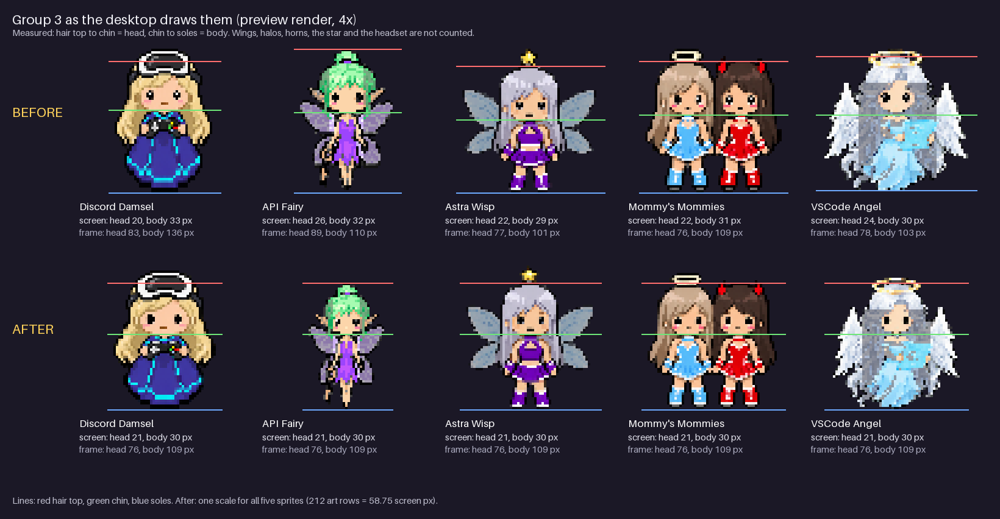

# Group 3: the same head and body size, 2026-10-17

By Claude Opus 5.5 (`claude-opus-5-5`) for Astra, 2026-10-17 and 2026-10-18. Every picture here is a **draft until
Astra approves it**. Follows [pet-art-redesign-20261017.md](pet-art-redesign-20261017.md), which gave group 3
Mommy's Mommies' body-to-head ratio but not the same pixel size.

## What Astra asked

From a screenshot of her desktop pets (2026-10-17): "these girls need the same body size exactly and head size".
The girls are group 3: Discord Damsel, API Fairy, Astra Wisp, Mommy's Mommies (Astra and Devilish, one sprite) and
VSCode Angel. Six girls in five sprites. Mommy's Mommies are the reference.

## How a girl is measured

On the 256 px frames, counting pixels with alpha 128 or more (the ones the desktop shows):

- **Hair top**: the first row of the hair outline. Halos, horns, wings, the star and the headset are not hair; API
  Fairy's bun is.
- **Chin**: the first row under the face, where the jaw ends. For the Damsel and the Fairy the skin goes on into the
  neck, so it is the row where the face narrows to the neck.
- **Soles**: the lowest opaque row (shoe soles, or the hem of a gown).
- **Head** = chin minus hair top. **Body** = soles minus chin.

Where an accessory covers the hair top, the hair top is read next to it: beside the Damsel's headset (the hair at
both sides), and inside VSCode Angel's halo ring. Mommy's Mommies' Astra wears her halo on her hair; Devilish has the
same rows everywhere else (eyes, chin, soles), so their hair top is read on Devilish, between her horns.

**Mommy's Mommies, idle: hair top 43, chin 119, soles 228, so head 76 and body 109.** The redesign record's 72 and 106
were read by eye; this is the same frame read row by row.

## What changed

| Girl | Before (idle): head / body | Edit | After: head / body |
| --- | --- | --- | --- |
| Mommy's Mommies (Astra, Devilish) | 76 / 109 | none: the reference | 76 / 109 |
| Discord Damsel | 83 / 136 | head, headset and width x0.916; gown 137 rows to 110 | 76 / 109 |
| API Fairy | 89 / 110 (bun to jaw) | head, bun and width x0.854; body 111 rows to 110 | 76 / 109 |
| Astra Wisp | 77 / 101 | head, star and width x0.987; body 102 rows to 110 | 76 / 109 |
| VSCode Angel | 78 / 103 | head, halo and width x0.974; body 104 rows to 110 | 76 / 109 |

**How**, so it can be redone (Python 3.13 and Pillow in a scratch folder, not committed: this repo uses Node built-ins
only). Each output pixel copies one source pixel, so no colour is new (checked on every frame):

1. Columns, and every row above the chin, are picked with one factor `f = 76 / head`, centred on the face: output
   column `x` takes source column `128 + floor((x - 128 + 0.5) / f)`. The head keeps its shape; accessories and wings
   scale with it.
2. Rows from the hair top to the chin become exactly 76 rows: output row `j` takes `T + floor((j + 0.5) * head / 76)`.
3. Rows from the chin to the soles become exactly 110 rows (body 109): `C + floor((j + 0.5) * (S - C + 1) / 110)`.
4. The soles land on row 236 of the frame, centred at column 128.
5. Every mood uses idle's rows moved with that mood's own offset (found by laying the mood's body over idle's), so
   each keeps its pose. Blink is idle with closed eyes and the desktop alternates the two, so blink is cut at its own
   measured rows (VSCode Angel's blink hem is one row lower than her idle).
6. API Fairy's source frames are her current web frames with the build's mood stickers removed (every island but the
   fairy herself), so her new sheet has none.

**Idle and blink measure exactly 76 / 109 for every girl.** The other moods keep their poses, so they read a few
pixels off, as Mommy's Mommies' own moods do (hers range from head 76 to 84 and body 99 to 109): for example the
Damsel's open-mouthed happy is 71 / 114 and VSCode Angel's sleep, head bowed, 86 / 96.

### The web frames: native sheets

`npm run build` fits every sheet so its drawing is about 200 px, which would give each girl her own scale again.
`scripts/build-frames.mjs` now has `NATIVE` for sheets drawn at frame size (API Fairy and Discord Damsel), and
`scripts/sheet-to-sprites.mjs` cuts those without fitting:

- the window is exactly one frame, the middle of each cell (where the frame was laid), so the frame comes back as it
  was, feet on the same row in every mood;
- every pixel of exactly the background colour is background, also between an arm and the body (left in, that grey
  took one of the 24 palette colours and pushed out the Fairy's pink blush);
- a drawing bigger than a frame, or outside the cell's middle, stops the build.

The sheets are the new frames laid 1:1 in the middle of each cell of a 1024 px sheet on solid `#808080`, alpha cut at
128 like the desktop does. Checked after `npm run build`: API Fairy's nine web frames are her new frames pixel for
pixel (one stray grey speck in her sad frame's wing is dropped by the build's speck filter); the Damsel's have the
same pixels in place through the build's 24-colour palette. Both measure exactly like the desktop frames.

### The desktop: one scale

`scripts/desktop-pets-20261011.cs` fitted each pet's alpha bounds to the standard height (58.75 logical pixels).
Halos, horns, the star, the headset and wings make those bounds different, so equal art was still drawn at five
scales (3.27 to 4.10 art pixels per screen pixel). Now the five group 3 sprites (`SameSize`) use one crop
`SameSizeCrop` = 212 art pixels tall, measured up from the soles (the tallest, Astra Wisp with her star, needs 211),
drawn 58.75 high: one scale for all, 3.609 art pixels per screen pixel. The self-test checks it ("group 3 same-size
scale").

**Proof, measured on preview renders** (`build-desktop-pets-20261011.ps1` in scratch copies of `main` and this
branch, then `bin\desktop-pets-check-20261011.exe <hub> --preview <png>`): each girl was found in the render by
drawing her frame the way GDI+ does (nearest neighbour, pixel offset half), and matched it pixel for pixel (GDI+ rounds
colours by up to 3 levels; wing pixels the app makes see-through are left out). Then each screen row is known to show
one art row:

| Girl | Before: head / body (screen px) | After: head / body |
| --- | --- | --- |
| Discord Damsel | 20 / 33 | 21 / 30 |
| API Fairy | 26 / 32 | 21 / 30 |
| Astra Wisp | 22 / 29 | 21 / 30 |
| Mommy's Mommies | 22 / 31 | 21 / 30 |
| VSCode Angel | 24 / 30 | 21 / 30 |

After: hair top on screen row 7, chin 28, soles 58 of every sprite. The preview draws at 100%; at 150% (Astra's
screen) every girl still has the same crop height and drawn height, so they still sample the same rows. Mommy's
Mommies are about 5% smaller on screen than before.

### Icons

`art/icons/` for `api-fairy`, `findastra-discord-presence` (the Damsel), `vrchat-ai-astra` (Astra Wisp) and
`vscode-angel`, made with `scripts/make-icons-20261012.mjs`' own steps (its trim and fit, copied into a scratch
script so nothing else is fetched; checked pixel-identical on `main`'s art first). Mommy's icon is unchanged.
`system-map-20261012.html` embeds them (`npm run build`).

## Every copy

| Repo | Pull request | What |
| --- | --- | --- |
| astras-pet-os | this branch, `claude/girls-same-size-20261017` | `desktop-art/` for the Damsel, Wisp and Angel; `art/sheets/` and rebuilt `art/frames/` for the Fairy and the Damsel; 4 icons; native sheets; one desktop scale; this record; card 031 |
| findastra-discord-presence | [#5](https://github.com/findastra/findastra-discord-presence/pull/5) | `desktop-art/discord-damsel/`, `pet-art/`, desktop record |
| api-fairy | [#3](https://github.com/findastra/api-fairy/pull/3) | `art/` frames, `assets/fairy.ico`, desktop record |
| the-astral-plane | [#4](https://github.com/findastra/the-astral-plane/pull/4) | `desktop-art/astra-wisp/`, desktop record |
| vscode-angel | [#3](https://github.com/findastra/vscode-angel/pull/3) | `desktop-art/vscode-angel/`, desktop record |
| mommys-mommies | [#3](https://github.com/findastra/mommys-mommies/pull/3) | desktop record only (the art is the reference) |
| findastra.github.io | [#4](https://github.com/findastra/findastra.github.io/pull/4) | `art/pets/` for the Fairy and the Damsel, 4 icons (merge after the hub) |

None is merged.

## Not done

- **Astra's desktop shows this only after a rebuild.** The size rule is compiled into the desktop app, and Startup
  Star's live sync restarts the app but does not rebuild it. The running exe also has the Goldfish triple-click from
  PR #23, which merged into `codex/yellow-phone-20261015`, not `main`, so rebuilding from `main` alone would drop it.
  Card [031](../handoffs/031-codex-rebuild-desktop-girls-same-size-20261017.md) asks Codex to rebuild with both.
- **Two questions for Astra**: should API Fairy's bun count as hair (it does now, so her face is drawn a little
  smaller than the others)? And the web frames of Astra Wisp, Mommy's Mommies and VSCode Angel are an older design
  than their desktop art; they were left as they are. If the web should match, their sheets can be replaced with the
  desktop designs, sized the same way.
- On web pages that show frames at frame size (`art/roster.png`, the portfolio's `art/pets/`), API Fairy and the
  Damsel now look smaller than pets whose sheets are fitted to about 200 px. That is the price of one pixel size for
  the girls; the other three girls' web frames are still fitted (older designs, above).
- The API Fairy app embeds her frames: it shows them after `build.cmd`. Folder icons on Astra's PC refresh with
  `set-folder-icons-20261017.ps1`.
- Generated files (`cage-data.js`, `system-map-20261012.html`, `art/roster.png`) conflict with any other branch that
  rebuilt them: whoever merges second runs `npm run build` again.
- `npm test`: 101 pass on a checkout with LF line endings. On a Windows checkout with `core.autocrlf=true`, two tests
  that compare generated docs fail on `main` too (line endings, not content).
