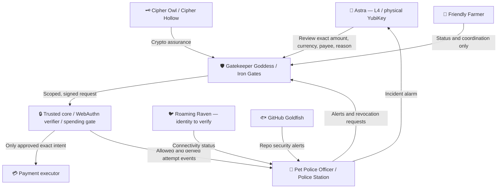

# Hardware-key-aware spending and internal security roadmap (2026-11-02)

Status: DESIGN / NOT DEPLOYED. No pet or website is currently guaranteed to enforce this policy.

## Non-negotiable spending rule
All actions that **commit, authorize, transfer, purchase, subscribe, renew, bid, donate, or otherwise obligate money** are high-risk. Default DENY for all agents, pets, automation, plugins, browser tools, API calls and delegated services. No auto-spend allowance and no silent recurring renewal. Even $0 authorization holds, changes to payment instruments and modifications to the spending policy require human review.

For every proposed transaction show L4 Astra: exact amount in minor units and ISO currency, merchant/payee legal identity and destination, itemized description, reason and beneficiary, taxes/fees/tip/shipping and **maximum total**, whether one-time or recurring, recurrence terms and cancellation, funding source label (never full card), and a short expiry. Any unknown or variable amount is DENIED until a hard maximum is specified. Any material change invalidates approval.

## Hardware-backed, transaction-bound approval
1. Trusted core generates an immutable canonical transaction intent (id, nonce, exact maximum total, currency, merchant, destination, reason, recurrence terms, expiry, requesting agent, policy version), hashes it and stores it pending.
2. A trusted, non-agent-controlled confirmation UI displays **the same canonical intent**. Do not trust an LLM-generated summary or web page alone.
3. L4 authenticates via phishing-resistant WebAuthn/FIDO2 with user verification and a challenge cryptographically bound to the pending intent hash, or a dedicated hardware-backed transaction-signing design after expert review. Validate RP ID/origin, challenge, authenticator response, user verification, expiry and replay protection server-side.
4. Core issues a single-use, narrowly scoped authorization bound to that exact intent and executor. The executor independently verifies merchant/amount before submitting. If a vendor cannot provide a verifiable amount or cannot enforce pre-submit approval, **block automated payment** and require manual purchase.
5. Record tamper-evident evidence of decision and actual outcome without storing PINs, private keys, recovery codes, payment credentials or full personal data. Refunds and cancellations are separately authorized operations.
6. On timeout, network outage, missing YubiKey, missing verifier, or policy failure: DENY spending. Never silently fall back to SMS, email, cached session, or a model's assertion. Preserve manual human recovery outside agent automation.

**Security caveat:** WebAuthn normally authenticates a challenge for a relying party; transaction semantics are enforced by the trusted application's challenge binding and confirmation UI, not by a YubiKey displaying an amount. The YubiKey itself does not display amount/reason. Do not claim ordinary GitHub YubiKey login approves PetOS payments.

## Division of responsibility
- **L4 Astra 👑:** final human decision, physical authenticator, recovery, policy changes.
- **Trusted core 🔒:** non-bypassable policy enforcement point, intent construction, approval verification, credential isolation, append-only audit and deny-by-default. Pets do not hold L4 payment credentials.
- **Gatekeeper Goddess / Iron Gates 🛡️:** owns YubiKey enrollment checklist and spending approval workflow; recommends policy, issues scoped grants through core, never self-approves.
- **Cipher Owl / Cipher Hollow 🗝️:** reviews WebAuthn/signature and canonicalization design, tracks nonsecret key metadata, validates provenance; never extracts YubiKey private keys.
- **Pet Police Officer / The Police Station 🚨:** watches **all attempted** privileged operations, including denied requests, privilege escalation, cross-pet tool calls, policy edits, token misuse, suspicious retries and requests to disable logging. Alerts and proposes scoped containment; no permission grants.
- **Log Lynx / Forensic Ferret:** protected audit trail and investigation, distinct from authorizer and monitored agents.
- **Backup Beaver:** backup authenticator/recovery-location inventory, no secrets in GitHub.
- **GitHub Goldfish:** monitors security-related repository and workflow changes, protected branch changes and suspicious CI/token activity; read-only alerts to Police and Gatekeeper, no payment authority.
- **Roaming Raven:** desired connectivity diagnostics for PC-to-phone remote access and secure session health; do not give it raw remote desktop credentials or bypass MFA. **Repository/name not yet verified; resolve registry identity before implementation.**
- **Friendly Farmer:** orchestration and UI, not an authorization bypass.

## Security team system map (design)

## Delivery milestones (do in order)
- **P0 — Security inventory and recovery:** inspect current branches and skills; resolve Raven identity; map actual payment pathways and remote-access software; register and test two YubiKeys on relevant services; check GitHub token permissions; verify OpenAI account sign-in method separately. No secret material in docs.
- **P1 — Core policy contract:** define canonical spend intent JSON schema, permission matrix, explicit denial semantics, event schema, approval UI mock, threat model and abuse tests. Include purchase via browser, API, CLI, recurring subscription, gift card and indirect tool calls.
- **P2 — Pet program dashboards:** follow Farmer's pet-program framework, taking Rift Rabbit/Wonderland Launchpad and Unity Unicorn/Stable as UI references. Build Iron Gates approvals inbox; Cipher Hollow key/crypto status; Police Station incident console; Goldfish repo alerts; Raven connection-health page once identified. Clearly label simulation vs real enforcement.
- **P3 — Implement enforcement:** isolate credentials from agents, intercept all authorized spending-capable tools, bind intent to WebAuthn challenge, verify transaction and single-use authorization in core, independently log denied attempts. Block unsupported spend routes.
- **P4 — Integrate & test:** adversarial tests for prompt injection, $5-to-$500 mutation, wrong payee, stale/replayed approval, cross-pet escalation, expired key, offline verifier, bypass through alternate tools, disabled monitor, false positives and recovery. No real money in tests.
- **P5 — Controlled rollout:** L4-reviewed security PRs, CI tests, no production spending until an end-to-end external audit of enforcement coverage. Activate monitoring read-only first, then carefully scoped containment.

## OpenAI authentication troubleshooting
A YubiKey does not automatically grant access to an OpenAI account's security settings. Determine whether the account uses password, Google, Apple, Microsoft or enterprise SSO; check whether passkey/security-key enrollment is offered for that account and sign-in method, and whether the key is enrolled with the actual identity provider. Do not remove existing recovery methods until alternatives are verified. Do not confuse GitHub enrollment with OpenAI enrollment.

## References
- Saltzer and Schroeder (1975), *The Protection of Information in Computer Systems*: least privilege, complete mediation, separation of privilege. https://doi.org/10.1109/PROC.1975.9939
- Denning (1987), *An Intrusion-Detection Model*: security event monitoring. https://doi.org/10.1109/TSE.1987.232894
- NIST SP 800-207, *Zero Trust Architecture*: policy decision and enforcement separation. https://doi.org/10.6028/NIST.SP.800-207
- NIST SP 800-63B-4, authentication and recovery. https://pages.nist.gov/800-63-4/sp800-63b.html
- W3C Web Authentication Level 3: RP-origin binding, challenges and authenticator verification. https://www.w3.org/TR/webauthn-3/
