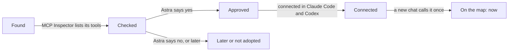

# MCP Roadmap

Which MCP servers the pets' chats use, which come next and which were left out, with the reason for each. By Astra.

An MCP server is a plug that lets the agent in a pet's seat (Claude Code, Codex, any harness that is an MCP client)
reach a program or a web account. It is a tool at L1: a 3rd party program, or a native tool when the farm made it.
The seat at L3 calls it, the steps for using it are a trick at L2, and its grant (who may use it, with what R W X) is
L4's. The research behind every row, all 87 pets checked, is in [mcp-assessment-20261109.md](mcp-assessment-20261109.md)
(hub card 319). Astra answered its questions on 2026-11-09: "All recommended".

## How a server moves

| Stage | What it means |
|---|---|
| **Found** | Someone named it, or the assessment found it; nothing about it is trusted yet. |
| **Checked** | MCP Inspector listed every tool it offers, and which ones write (White Hat Weasel keeps the Inspector). |
| **Approved** | Astra (L4) said yes, for which pets and with what R W X. |
| **Connected** | Set up in each seat that uses it: Claude Code (a Claude connector or its settings) and Codex (`config.toml`). |
| **On the map: now** | A new chat listed it and one read-only call answered; its System Map node and its pill go from `planned` to `now`. |

## Now and next: approved

| # | MCP server | Keeper → users | Stage | Next step |
|---|---|---|---|---|
| 1 | The Farm's own read-only server (`astras-pet-os-mcp`, #254) | Friendly Farmer → every pet's chats | On the map: now (2026-11-11) | Registered in Claude Code and Codex by its script, run outside the Claude app. `claude mcp list`: Connected; Codex lists it enabled; one `get_pet` call answered. New chats get it. |
| 2 | MCP for Unity (Coplay) | Unity Unicorn → Astra Wisp, Dubstep Gunsmith, Pole Puff, Piranesi Nessi, Door Dormouse, Reactor Raccoon | Connected | Card 306's first check with Unity open; Liminal Doors is on the D: drive, which was not plugged in on 2026-11-11 |
| 3 | Context7 (library docs) | AI Dashund → every coding chat | On the map: now | Codex has none (a new decision) |
| 4 | Microsoft Learn (Windows, PowerShell, C#) | PC Master → every chat writing Windows code | On the map: now (2026-11-12) | Astra connected it in Claude; one docs search answered. In Codex's `config.toml` too; not yet called from a Codex chat |
| 5 | MCP Inspector (the checker, run, never connected) | White Hat Weasel → every new server | On the map: now | Used for rows 4, 6 and 7 on 2026-11-09 |
| 6 | alphaXiv and PubMed | Paper Patty → Flowsheet Flamingo, AI Dashund | On the map: now (2026-11-12), Claude only | Astra connected both; one search each answered. alphaXiv offers 23 tools, not the 6 its directory listing showed: 9 of them write to her alphaXiv account (folders, saved papers, private notes, follows), and Paper Patty's grant is read only. Astra decides whether to switch those 9 off in the connector's settings |
| 7 | Yelp | Spoonfed Sugarcube | On the map: now (2026-11-12), Claude only | Astra connected it; one restaurant search answered. The chat gets only the search tool |

## Later: when that pet's work starts

| # | MCP server | Pet(s) | Waits for |
|---|---|---|---|
| 8 | Blender add-on for MCP for Unity's Blender bridge | Unity Unicorn | The next model that moves from Blender to Unity |
| 9 | Microsoft 365 server, OneNote preset, read-only (Softeria) | Project Parrot | Project Parrot being built |
| 10 | DWSIM headless and PubChem | Flowsheet Flamingo | #299 (The Pilot Plant's seed) |
| 11 | ableton-mcp | Drum Dog | A test on Live Lite next to the APC64 |
| 12 | ElevenLabs (hosted) | Astra Wisp | The Astral Plane starting again; it costs credits |
| 13 | ssh-mcp | Raspberry Pi Berry, Linux Penguin | Their Linux work |
| 14 | Playwright MCP (Safari's WebKit engine) | Platform Platypus → Browser Bat, Test Tortoise | iPhone and iPad Safari checks |
| 15 | Docker MCP Toolkit | Docker Dragon → Pet Police Officer | Three or more local third-party servers |
| 16 | Hugging Face | Llama Librarian | Llama Librarian leaving the roadmap |
| 17 | Gmail and Google Calendar (already connected through a plugin) | Mail Snail, Calendar Crow, Mommy's Mommies | Those pets being built; read-only first. Astra uses Google (Android) and iCloud; iCloud waits for a safe Windows option |
| 18 | Stripe | Data Chip | Data Dealer leaving the plan stage; sandbox only |
| 19 | Canva | Mommy's Mommies, Gif Giraffe | Flyers made in Canva |

## Not adopted

| # | MCP server | Why not |
|---|---|---|
| 20 | GitHub's official server | `gh` already does it |
| 21 | Everything search servers | `es.exe` already does it; File Master's own connector is planned |
| 22 | Windows-MCP | Goes around the seat's approvals |
| 23 | Discord servers | No official one, no read-only mode |
| 24 | Mail servers (IMAP, iCloud) | Small repos holding mail passwords; none runs well on Windows |
| 25 | Finance and health servers | Finance Finch and Health Hummy keep their data on the PC |
| 26 | VRChat API and OSC servers | Unmaintained or brand new; long-lived login token |
| 27 | LinkedIn servers | LinkedIn's terms ban automated access |
| 28 | OBS, Spotify, Stream Deck, Meshtastic, RGB, ffmpeg | No pet needs it, or the shell does it |
| 29 | Kali, Wireshark, Tailscale, Sentry, memory | Open shells, stale, or the command line covers it |
| 30 | Serena (Oraios AI's coding tool) | "Keep it off" (Astra, 2026-11-09); taken out of #255 |

The ten plugin servers that wait for a sign-in (Asana, Atlassian, Datadog, Linear, Notion, PagerDuty, Slack, Figma,
Intercom, GitHub) are **left as they are** (Astra, 2026-11-11: "Can you just do all this stuff for me?", which took the
recommended choice). Claude Code has no setting that turns off one plugin server everywhere. Without her sign-in they
cannot connect or offer a tool, so all they cost is the "needs sign-in" notices.

## Keeping it true

Update a row when a server changes stage, in the same pull request as the change, with the date. The System Map is
where a server's node, links and grant live (`system-map.json`); this page is the list.
