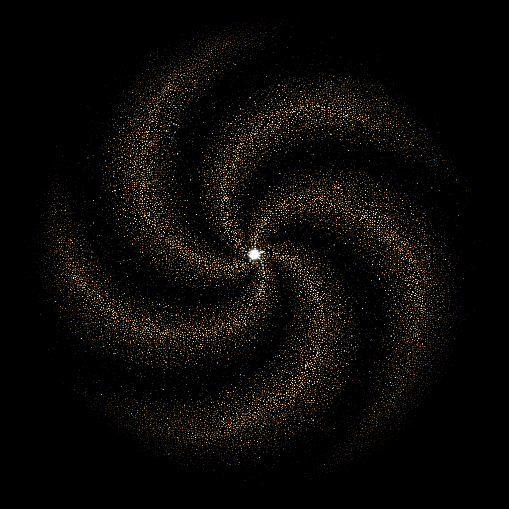

# AI IPO Countdown

*By Astra.*

Count down to an AI company's first day on the stock market, on your Discord profile. One small Windows app per
company: **Anthropic** first, **OpenAI** next.

## The Card

**Anthropic IPO** 
Nasdaq: ANT · Thu, Nov 19 
4 days to go

 

| When | What the card says |
| --- | --- |
| Days before | `4 days to go` (weeks when it's more than 8 weeks away) |
| Pricing day | `Pricing today`, then `Priced · trading tomorrow` |
| The day before, without a pricing date | `Trading tomorrow` |
| The last 24 hours | Discord's own live timer, such as `5:12:33 left`, and `Opening bell today` on the day |
| After the opening bell | `Now trading on Nasdaq: ANT` · `It's here!`, with Discord counting up from the bell, for a day |

Then the card goes away by itself. **Hide Date** keeps the date off the card.

The picture is the gold galaxy Astra approved for Anthropic Discord Presence on October 30, 2026, the same animated
GIF, loaded from [AI Discord Presence](https://github.com/findastra/ai-discord-presence). The app's page draws it
live, star by star, with the countdown to the opening bell under its core.

## Install

1. Install [Node.js 24 or later](https://nodejs.org/en/download). No `npm install` is needed.
2. Download this repo (Code › Download ZIP) and unzip it somewhere it can stay.
3. In `anthropic-ipo-countdown`, double-click `start-anthropic-ipo-countdown-20261115.cmd`. Its page opens in your
   browser by itself (port 38767, on this PC only).
4. Paste a Discord Application ID once under **Dates & setup** (until the app's own is built in), then **Start**.
5. To start it quietly every time Windows starts, double-click `enable-automatic-startup-20261115.cmd` once.

Discord desktop must be running. In Discord, User Settings › Activity Privacy › *Share your detected activities with
others* must be on for friends to see the card.

## The dates

The dates are the ones reported on November 15, 2026: Anthropic's roadshow began November 10, pricing is expected on
or about November 18, and trading on Nasdaq as ANT on November 19. **They are not final.** If they move, change them
under **Dates & setup**; the card follows at once. The first trade counts to 9:30am in New York, the opening bell.

## Privacy

The app reads nothing on your PC. It sends Discord only the card. Settings stay in `.local/config.json` in the app
folder.

## Adding a company

Each app is one folder. For OpenAI: copy `anthropic-ipo-countdown/` to `openai-ipo-countdown/`, then change
`EDITION` (company, ticker, exchange, dates) and `GALAXY_URL` in `src/card-20261115.js` to OpenAI Discord Presence's
blue galaxy, the galaxy files in `public/` (and `data-official-galaxy="openai"` in the page), `port` (38768) in `EDITION`, and the names in the launcher, Startup file and
tests. One Discord application can serve every company: the card's title comes from the app.

## Files (each app)

| Path | What it does |
| --- | --- |
| `src/card-20261115.js` | The company, the dates, and what the card says at each moment |
| `src/rpc-20261115.js` | Talks to Discord desktop over its local pipe |
| `src/server-20261115.js` | The app: the control page and the card updates |
| `src/launch-20261115.js` | Starts the app once, or opens the page if it's already running |
| `src/windows-startup-20261115.js` | Writes or removes the app's file in the Windows Startup folder |
| `public/official-galaxy-*-20261030.*`, `public/galaxy-card.gif` | The approved galaxy, copied from AI Discord Presence |
| `test/app-test-20261115.js` | `node --test` |

## License

[MIT](LICENSE).

Anthropic, OpenAI, Nasdaq and Discord are trademarks of their owners. This is an independent project, not made,
endorsed or sponsored by them, and not financial advice; their names appear only to say what is being counted down to.
