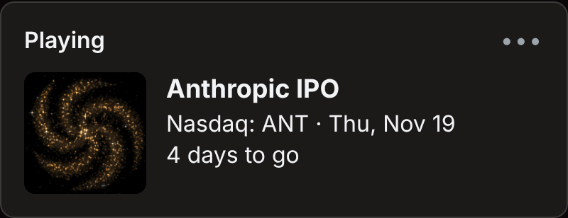
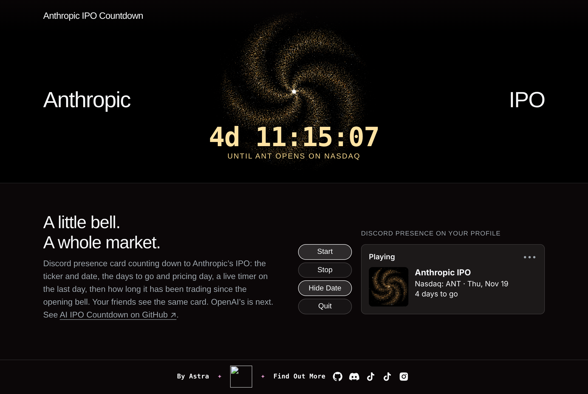
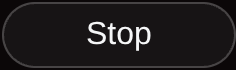

# AI IPO Countdown

*By Astra.*

Let your Discord friends count down with you to an AI company's first day on the stock market. One small Windows app
per company: Anthropic now, OpenAI next.

## The Card

What your friends see on your Discord profile while the app is sharing:

<table>
<tr>
<th width="50%"><a href="anthropic-ipo-countdown/README.md">Anthropic IPO Countdown</a> Nasdaq: ANT</th>
<th width="50%">OpenAI IPO Countdown next, when its date is set</th>
</tr>
<tr>
<td width="50%"></td>
<td width="50%" align="center">Coming next, with OpenAI's blue galaxy (<a href="ADDING-A-COMPANY.md">how</a>).</td>
</tr>
</table>

The company, the ticker and date, the days to go and pricing day, Discord's live timer on the last day, then how long
it has been trading since the opening bell. A day after the bell the card turns itself off.

## Official Artwork

The card and the page use the galaxies Astra approved for [AI Discord Presence](https://github.com/findastra/ai-discord-presence)
on October 30, 2026: individual gold (Anthropic) or blue (OpenAI) stars flowing into a white core, with the outside
fading completely to black. The page draws the galaxy live, star by star, with the countdown to the opening bell under
its core; Discord shows the same seamless 25-fps GIF as Anthropic Discord Presence.
[Artwork, source and reproduction](https://github.com/findastra/ai-discord-presence/blob/main/docs/official-galaxy-artwork-20261030.md).

## The App

A small program on your PC. Its page opens in your browser and shows a live preview of your card.

<table>
<tr>
<th width="50%">Anthropic IPO Countdown</th>
<th width="50%">OpenAI IPO Countdown</th>
</tr>
<tr>
<td width="50%"></td>
<td width="50%" align="center">Coming next.</td>
</tr>
<tr>
<td align="center"><b><a href="https://github.com/findastra/ai-ipo-countdown/raw/main/downloads/anthropic-ipo-countdown.zip">⬇ Download for Windows</a></b></td>
<td align="center">Coming next.</td>
</tr>
<tr>
<td align="center"><a href="anthropic-ipo-countdown/README.md">Everything about the Anthropic app</a></td>
<td></td>
</tr>
</table>

**Needs:** Windows, [Node.js 24 or later](https://nodejs.org/en/download) and the Discord desktop app with activity
sharing on.

### Buttons & Instructions

<table>
<tr>
<th width="200">Button</th>
<th>What it does</th>
</tr>
<tr>
<td width="200" align="center" valign="middle"></td>
<td valign="middle">Puts the card on your profile, until you click Stop or Quit. The app starts sharing again when it starts.</td>
</tr>
<tr>
<td width="200" align="center" valign="middle"></td>
<td valign="middle">Takes the card off your profile. The app keeps running.</td>
</tr>
<tr>
<td width="200" align="center" valign="middle"></td>
<td valign="middle">Takes the date off the card. Click it again (Show Date) to put it back.</td>
</tr>
<tr>
<td width="200" align="center" valign="middle"></td>
<td valign="middle">Closes the app. Click it twice within 3 seconds.</td>
</tr>
</table>

## Quirks

1. **The dates are reported, not final.** As of November 15, 2026: pricing on or about November 18, first trade on
   Nasdaq as ANT on November 19, counted to the 9:30am opening bell in New York. If they move, change them in
   `.local/config.json` ([how](anthropic-ipo-countdown/README.md#the-dates)).
2. Discord draws a live timer only from a time, so far from the bell the card counts **days** in words, and the live
   `5:12:33 left` appears in the last 24 hours. Days are counted in your PC's time zone.
3. After the bell the timer counts **up** from the opening bell, for a day; then the card turns itself off.
4. **Until the app's own Discord application is registered**, add an Application ID once in `.local/config.json`
   ([how](anthropic-ipo-countdown/README.md#start-it)). The line under the card says so until it is set.
5. AI Discord Presence and this app can run together, but Discord may show only one card; check your profile to see
   what friends see.
6. **Privacy:** the app reads nothing on your PC. Only the card goes to your Discord.
7. To update, click **Quit** in the old copy first (the launcher refuses to let an older copy stand in), and run
   **Enable Automatic Startup.cmd** again if you moved the folder.
8. Not financial advice. The card counts down; it never says to buy.

## Developer Notes

1. **What's where:** one folder per app (`anthropic-ipo-countdown/`, with `src/`, `public/`, `scripts/` and `test/`);
   `downloads/` holds the built ZIPs; `docs/images/` has the README pictures; `test/` checks names and the controls page
   across every app.
2. **Run from source:** `node src/server-20261115.js` in an app folder. The page uses port 38767 (Anthropic); OpenAI's
   will use 38768. `ANTHROPIC_IPO_PORT` changes it. The server listens on 127.0.0.1 only and checks Host and Origin on
   every change.
3. **Settings** live in each app's git-ignored `.local/config.json`. Never commit it, or any log or cache.
4. **Tests** (every app plus the naming rules): `node --test`. Add tests with every behavior change. **Rebuild the
   downloads** with `node scripts/package.mjs` before pushing any app change. No dependencies.
5. **The card's galaxy** is loaded by Discord from AI Discord Presence's `galaxy-card.gif` (`GALAXY_URL` in
   `src/card-20261115.js`), whose address that repo keeps fixed. Never redraw the galaxies here.
6. **The company, ticker, exchange and dates** are one `EDITION` in `src/card-20261115.js`, with the date they were
   read and the source.
7. **Adding another company:** copy the folder and change its `EDITION`, galaxy and port. Step by step:
   [ADDING-A-COMPANY.md](ADDING-A-COMPANY.md).
8. **Rules and handoffs:** [CLAUDE.md](CLAUDE.md) and [AGENTS.md](AGENTS.md) for contributors and AI assistants; open
   work in [handoffs/](handoffs/README.md); report a vulnerability through [SECURITY.md](SECURITY.md).

## Credits

1. Anthropic IPO Countdown: built with Claude Opus 5.5, from 2026-11-15.
2. The Discord connection, launcher and Windows startup come from
   [Ableton Live Discord Presence](https://github.com/findastra/ableton-live-discord-presence); the page, the card and
   the galaxies from [AI Discord Presence](https://github.com/findastra/ai-discord-presence).
3. Full list: the "Built with" lines in [AGENTS.md](AGENTS.md).

## License

MIT, see [LICENSE](LICENSE).

Anthropic, OpenAI, Nasdaq and Discord are trademarks of their owners. This is an independent project, not made,
endorsed or sponsored by them; their names appear only to say what is being counted down to.
