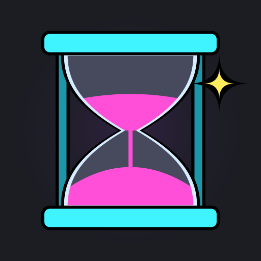

# Countdown Discord Presence

*By Astra.* Count down to your big day on your Discord profile. One small Windows app.

## The Card

**Countdown** 
My birthday 
12 days to go · Fri, Dec 25

 

- **What you're counting down to** and **how many days are left**, with the date. Far-off days read as weeks.
- **Tomorrow** the night before, **Today** on the day, and on the last 24 hours Discord's own live timer, such as
  `5:12:33 left`.
- When the moment comes the card says **It's here!** for a day, then goes away by itself.
- **Hide Date** keeps the date off the card. Hover the picture to see the date.

## Install

1. Install [Node.js 24 or later](https://nodejs.org/en/download). No `npm install` is needed.
2. Download this repo (Code › Download ZIP) and unzip it somewhere it can stay.
3. Double-click `start-countdown-discord-presence-20261115.cmd`. Its page opens at <http://127.0.0.1:38767/>.
4. Type what you're counting down to and choose the date and time, then Save and Start.
5. To start it quietly every time Windows starts, double-click `enable-automatic-startup-20261115.cmd` once.

Discord desktop must be running. In Discord, User Settings › Activity Privacy › *Share your detected activities with
others* must be on for friends to see the card. Until the app's own Discord application is registered, paste a
Discord Application ID on the page once (Discord Developer Portal › New Application › copy its Application ID; no
token is needed).

## Privacy

The app reads nothing on your PC. It sends Discord only the card: the title, what you're counting down to and the
date. Settings stay in `.local/config.json` in the app folder.

## Files

| Path | What it does |
| --- | --- |
| `src/card-20261115.js` | What the card says at each moment, and the settings |
| `src/rpc-20261115.js` | Talks to Discord desktop over its local pipe |
| `src/server-20261115.js` | The app: the control page at port 38767 and the card updates |
| `src/launch-20261115.js` | Starts the app once, or opens the page if it's already running |
| `src/windows-startup-20261115.js` | Writes or removes `countdown-discord-presence-20261115.vbs` in the Startup folder |
| `scripts/make-hourglass-art-20261115.js` | Draws the hourglass and writes the card picture and the 1024×1024 icon (`npm run art`) |
| `test/app-test-20261115.js` | `node --test` |

## Limits

- Windows and Discord desktop only (not the browser version of Discord).
- One countdown at a time. Discord shows one card per app.
- Days are counted in your PC's time zone.

## License

[MIT](LICENSE).
